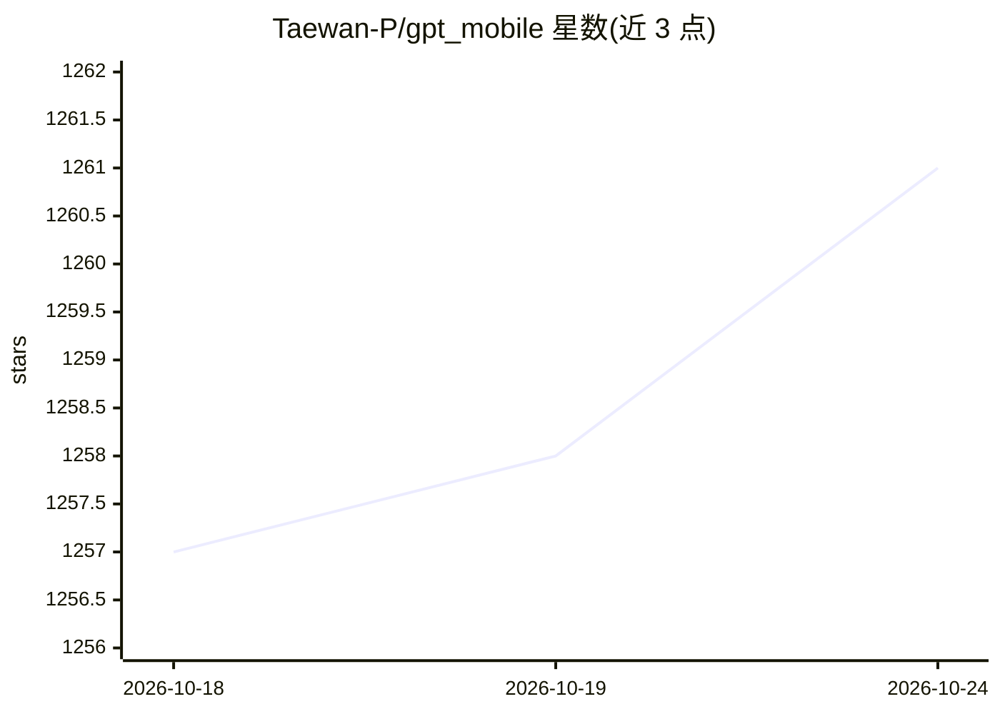

# Taewan-P/gpt_mobile

⭐ 1,261 · Kotlin · GPL-3.0 · 推送 2026-10-10 · [GitHub](https://github.com/Taewan-P/gpt_mobile) · 个人维护

**Android 多模型 AI 聊天客户端，BYOK 接入多家 LLM**

用 Kotlin/Jetpack Compose 编写的 Android 聊天应用：用户自带 API key，可同时向多个模型提问并排对比回答，支持 OpenAI、Anthropic Claude、Google Gemini、Groq 与 Ollama，可自定义温度、top p、系统提示词、API URL 与模型。每个 provider 配置可选配 agent 工具：原生 tool calling、Firecrawl/Perplexity/Exa 网页搜索、MCP Streamable HTTP 服务器（bearer/OAuth 认证），支持并行运行与持久 trace。聊天记录仅本地保存，凭据用 Android Keystore 加密。通过 F-Droid、Google Play 与 GitHub Releases 分发。

## 筛选速览

| 维度 | 判定 | 备注 |
|---|---|---|
| AI 角色 | `ai-native` | 本体是模型或模型工具 |
| 许可风险 | `viral` | GPL-3.0 |
| 部署形态 | `None` |  |
| 模型依赖 | local-ok | 支持本地模型 |
| 硬件要求 | — | 无带数字的原话,不猜 |
| 安装摩擦 | `low` | 无编译、无系统依赖或容器化 |
| 成熟度 | — | 结构信号不足 |

## 能力要点

- 同时向多个模型提问并对比回答
- 支持 OpenAI/Anthropic/Gemini/Groq/Ollama，自定义 API URL 与模型
- 每 profile 可选配 agent 工具：tool calling、网页搜索、MCP 服务器
- 聊天记录仅本地保存，凭据经 Android Keystore 加密且排除于备份导出

## 适用场景

- 在手机上用同一个应用访问多家 LLM 服务
- 并排对比多个模型对同一问题的回答
- 带自己的 API key 使用，不让聊天数据离开本地存储（除发往所选 provider）

## 场景标签

`聊天机器人` · 领域:对话与助手

## 证据(README 行号)

> L21: - **Chat with multiple models at once**
> L38:  - Chat history is **only saved locally**

## 星数曲线

2026-10-18 1,257 → 2026-10-24 1,261（+4）

---
*卡片 v1 · prompt 1.4 · 生成 2026-10-21 · 置信度 high · 依据 README sha `a032ed172a3b` · [字段定义](../../DATASET.md)*
