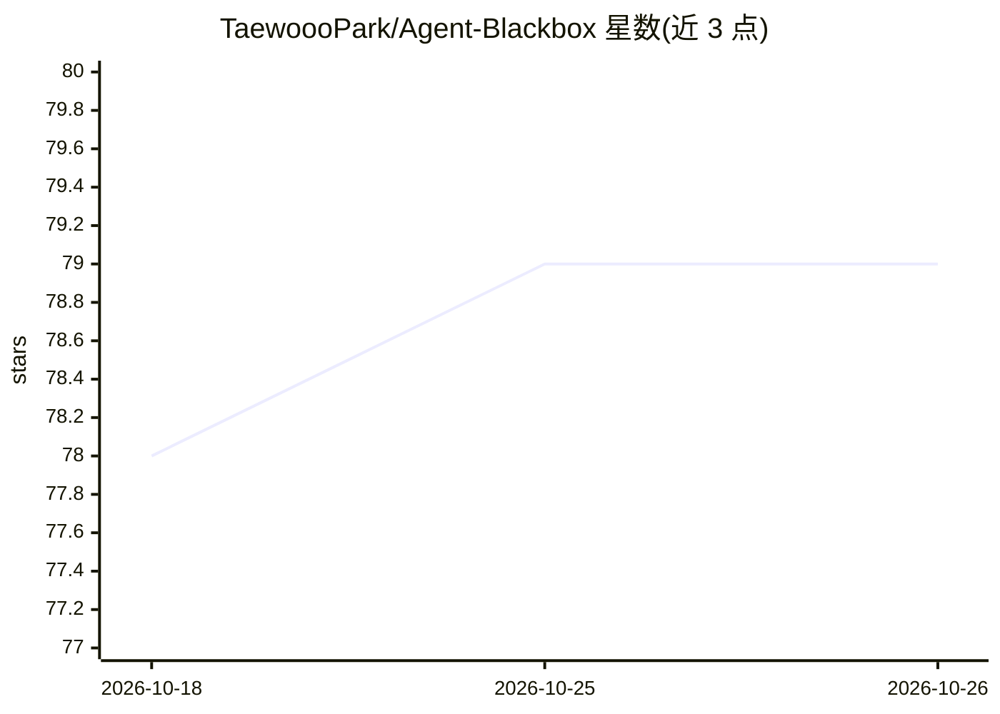

# TaewoooPark/Agent-Blackbox

⭐ 79 · TypeScript · MIT · 推送 2026-10-15 · [GitHub](https://github.com/TaewoooPark/Agent-Blackbox) · [官网](https://www.npmjs.com/package/@taewooopark/agent-blackbox) · 个人维护 · 中文 README

**编程 agent 的本地飞行记录器：回放运行图并评分上下文开销**

面向 Claude Code、Codex、OpenCode、Motifcode 等编程 agent 的本地优先观测工具：守护进程跟踪各 agent 已写出的会话转录文件，把每次运行重建为可实时回放、可缩放拖拽的 session map（含子 agent 谱系），并从 11 项指标（缓存命中、冗余读取、重试浪费等）计算上下文效率分与任务结果分，给出具体优化建议，可由免 API key 的免费模型生成。一条 npx 命令启动，数据不出本机；评分按任务类型与项目内历史运行校准，支持自定义规则与交接导出。

## 筛选速览

| 维度 | 判定 | 备注 |
|---|---|---|
| AI 角色 | `ai-ecosystem` | LLM/agent 周边工具 |
| 许可风险 | `permissive` | MIT |
| 部署形态 | `library` | 以包/库形式分发 |
| 模型依赖 | local-ok | 支持本地模型 |
| 硬件要求 | — | 无带数字的原话,不猜 |
| 安装摩擦 | `low` | 无编译、无系统依赖或容器化 |
| 成熟度 | — | 结构信号不足 |

## 能力要点

- 跟踪本地会话转录重建可回放的实时 session map
- 11 项指标的上下文效率评分与任务结果双轴打分
- 本地优先、无需 API key，一条 npx 命令启动
- 支持 Claude Code / Codex / OpenCode / Motifcode 等多种 host

## 适用场景

- 回放编程 agent 的实际执行过程，核对其自我总结
- 量化每次 agent 运行的 token 与上下文开销
- 生成结构化交接摘要以便恢复或交接任务

## 场景标签

`LLM 可观测性` · 领域:评测与运维

## 证据(README 行号)

> L28: Agent-Blackbox is a **local-first flight recorder and context-efficiency profiler for coding agents.** It turns eve
> L52: **One command. Works with Claude Code, Codex, OpenCode, and Motifcode** (needs Node 20+):

## 星数曲线

2026-10-18 78 → 2026-10-26 79（+1）

---
*卡片 v1 · prompt 1.4 · 生成 2026-10-24 · 置信度 high · 依据 README sha `f4f57e026056` · [字段定义](../../DATASET.md)*
