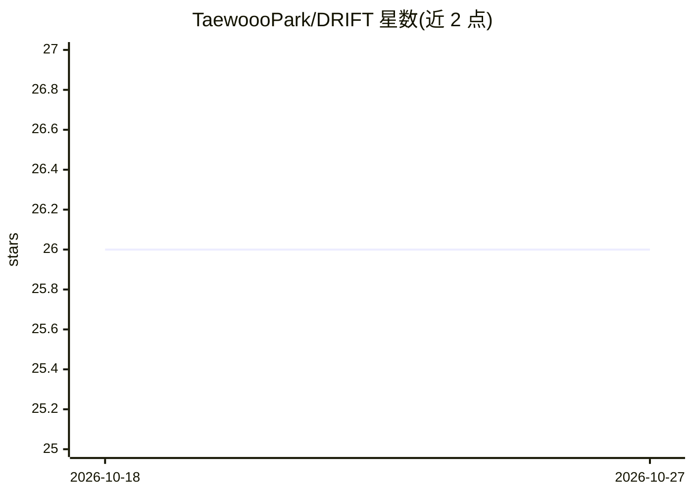

# TaewoooPark/DRIFT

⭐ 26 · Python · MIT · 推送 2026-07-06 · [GitHub](https://github.com/TaewoooPark/DRIFT) · [官网](https://www.taewoopark.com/projects/DRIFT) · 个人维护 · 中文 README

**把一个 LLM 按层拆到 Mac(MPS)+PC(CUDA) 多机联合推理的运行时**

DRIFT 是一个无服务器、点对点的分布式 LLM 推理网络：把一个模型按 decoder 层切分到异构个人设备（Apple MPS 与 NVIDIA CUDA）上流水线并行运行，节点间仅通过框架无关的加密字节协议（TCP+msgpack）传输隐状态，不依赖 torch.distributed/NCCL。输出与单机运行逐位一致，提供逐跳 Ed25519 签名回执、逐位故障恢复、gossip 节点发现与贡献账本；支持最多 28 节点（Gemma 35）。"For Tokens" 代币经济与链上结算仍属愿景，未实现。

## 筛选速览

| 维度 | 判定 | 备注 |
|---|---|---|
| AI 角色 | `ai-ecosystem` | LLM/agent 周边工具 |
| 许可风险 | `permissive` | MIT |
| 部署形态 | `None` |  |
| 模型依赖 | — | README 未给出锁定关系 |
| 硬件要求 | — | 无带数字的原话,不猜 |
| 安装摩擦 | `medium` | 含编译或系统依赖之一 |
| 成熟度 | — | 结构信号不足 |

## 能力要点

- 按层流水线切分，MPS 与 CUDA 异构 GPU 同跑一个模型，输出与单机逐位一致
- 框架无关加密线协议（TCP+msgpack，X25519+ChaCha20-Poly1305）
- 逐跳 Ed25519 签名回执与逐位故障恢复、点对点链式传输（--chain）
- 每节点持本层 KV cache，线上每 token 仅约 1.5–3KB 隐状态

## 适用场景

- 用一台 Mac 和一台 NVIDIA PC 合跑一个单机放不下的模型
- 异地朋友各留一台机器，联合运行同一模型
- 跨 GPU 厂商的局域网/隧道分布式推理实验

## 场景标签

`推理引擎` · 领域:训练与推理

## 证据(README 行号)

> L33: **DRIFT** runs **one** large language model across **heterogeneous personal machines** — a Mac (Apple GPU, PyTorch 
> L68: A server-less, peer-to-peer inference network: heterogeneous personal devices split **one** model by layer and run 

## 星数曲线

2026-10-18 26 → 2026-10-27 26（+0）

---
*卡片 v1 · prompt 1.4 · 生成 2026-10-26 · 置信度 high · 依据 README sha `55e0f88ad380` · [字段定义](../../DATASET.md)*
