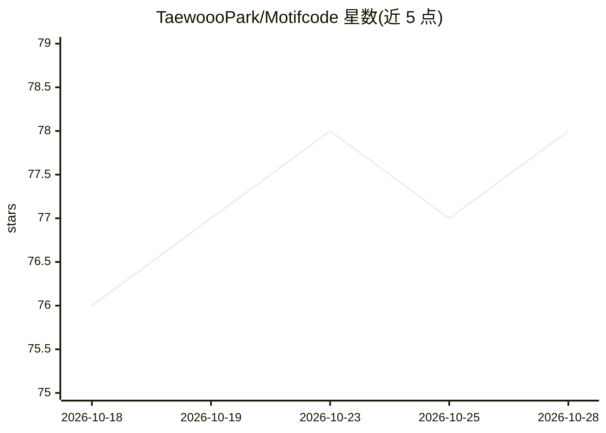

# TaewoooPark/Motifcode

⭐ 78 · TypeScript · Apache-2.0 · 推送 2026-10-17 · [GitHub](https://github.com/TaewoooPark/Motifcode) · 个人维护 · 中文 README

**专为 Motif-3 模型构建的终端编码 agent**

Motifcode 是一个单文件、零运行时依赖的终端编码 agent 客户端（npm 包），界面形态为 Claude Code 式的对话记录与提示框，含 `/` 命令、`@` 提及、权限确认与 `.motif/` 项目目录。其工具集、prompt 布局、解析与失败处理针对 Motif-3（314B-A13B、256K 上下文）模型特性设计。接入方式为选择 Infron 或 Morphfactory 提供商并保存 API key；支持 MCP 服务器（stdio/HTTP/SSE，8 个内置预设）、技能系统、会话恢复与 OAuth 登录。需 Node 20.3+。项目为社区独立项目，非 Motif Technologies 官方产品，处于 alpha 阶段。

## 筛选速览

| 维度 | 判定 | 备注 |
|---|---|---|
| AI 角色 | `ai-native` | 本体是模型或模型工具 |
| 许可风险 | `permissive` | Apache-2.0 |
| 部署形态 | `library` | 以包/库形式分发 |
| 模型依赖 | — | README 未给出锁定关系 |
| 硬件要求 | — | 无带数字的原话,不猜 |
| 安装摩擦 | `low` | 无编译、无系统依赖或容器化 |
| 成熟度 | — | 结构信号不足 |

## 能力要点

- 终端交互式编码 agent，针对 Motif-3 单一模型设计工具集与解析器
- 支持 MCP 服务器接入（stdio/Streamable HTTP/SSE）与 8 个内置预设
- 支持技能安装（本地/Git/Claude/Codex/marketplace 包）与会话记录恢复
- 单文件 npm 包，无运行时依赖，含 `motif doctor` 端点诊断

## 适用场景

- 在终端里用 Motif-3 模型完成编码任务
- 为编码 agent 接入 GitHub、浏览器、文档等 MCP 外部工具
- 从 Codex 或 Claude 配置导入 MCP 服务器设置

## 场景标签

`编码 Agent` · 领域:编码与开发

## 证据(README 行号)

> L3:  A coding agent harness built for one model: Motif-3.
> L31: Motifcode is a terminal coding agent in the shape of Claude Code — a transcript
> L67: marked down on can be raised far enough with open source.** The harness is

## 星数曲线

2026-10-18 76 → 2026-10-28 78（+2）

---
*卡片 v1 · prompt 1.4 · 生成 2026-10-24 · 置信度 high · 依据 README sha `84976c4a26e1` · [字段定义](../../DATASET.md)*
