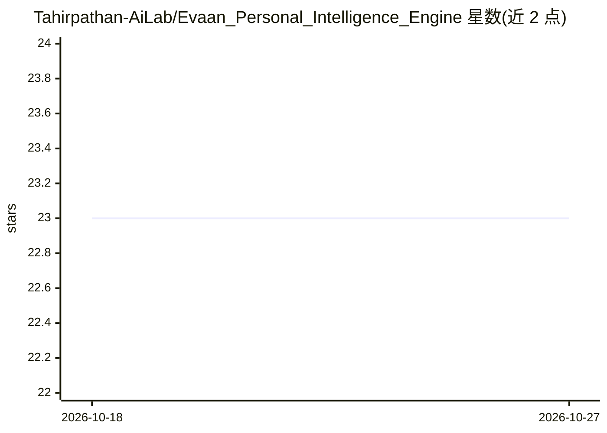

# Tahirpathan-AiLab/Evaan_Personal_Intelligence_Engine

⭐ 23 · Python · MIT · 推送 2026-09-12 · [GitHub](https://github.com/Tahirpathan-AiLab/Evaan_Personal_Intelligence_Engine) · [官网](https://mrtahirpathan.netlify.app/) · 个人维护

**本地 CPU 运行的 AI 陪伴聊天机器人，带人设与持久记忆**

基于 Python/PyTorch/Hugging Face Transformers 的终端聊天机器人，在用户本机加载 Qwen2.5-0.5B-Instruct 模型，无需 API key、无需联网（仅首次下载模型权重）。通过固定系统提示词塑造名为 Evaan 的人格，用正则规则检测英语与印地语/印英混合的责备与道歉语气以更新情绪状态，并将对话历史与情绪序列化到 evaan_memory.json 实现跨会话记忆；身份类固定问题用硬编码回答绕过模型，上下文裁剪至最近 20 条消息。无需微调，面向消费级 CPU 硬件运行。

## 筛选速览

| 维度 | 判定 | 备注 |
|---|---|---|
| AI 角色 | `ai-native` | 本体是模型或模型工具 |
| 许可风险 | `permissive` | MIT |
| 部署形态 | `None` |  |
| 模型依赖 | — | README 未给出锁定关系 |
| 硬件要求 | `cpu-ok` | |
| 安装摩擦 | `low` | 无编译、无系统依赖或容器化 |
| 成熟度 | — | 结构信号不足 |

## 能力要点

- 本地运行 Qwen2.5-0.5B-Instruct，无需 API key 与持续联网
- 正则规则检测英语/印地语责备与道歉语气并更新情绪状态
- 对话历史与情绪持久化到 evaan_memory.json，跨会话记忆
- 身份问题硬编码回答与上下文裁剪（最近 20 条）

## 适用场景

- 在 CPU 笔记本上离线运行 AI 陪伴聊天
- 原型化带人格设定且无需微调的聊天机器人
- 学习提示工程与持久记忆的 LLM 应用结构

## 场景标签

`聊天机器人` · 领域:对话与助手

## 证据(README 行号)

> L3: **Evaan** is a fully local, CPU-based **conversational AI companion chatbot** built with **Python**, **PyTorch**, an
> L15: The workflow begins the moment the script is run from the terminal. On startup, Evaan loads any previously saved co

## 星数曲线

2026-10-18 23 → 2026-10-27 23（+0）

---
*卡片 v1 · prompt 1.4 · 生成 2026-10-27 · 置信度 high · 依据 README sha `d17faab1dc58` · [字段定义](../../DATASET.md)*
