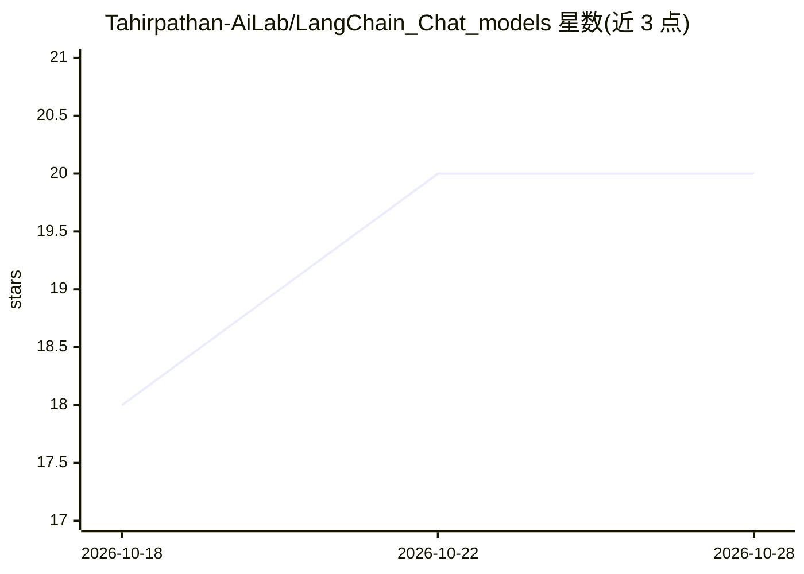

# Tahirpathan-AiLab/LangChain_Chat_models

⭐ 20 · Python · 推送 2026-09-05 · [GitHub](https://github.com/Tahirpathan-AiLab/LangChain_Chat_models) · [官网](https://mrtahirpathan.netlify.app/) · 个人维护

**LangChain 入门教程仓库：配套视频的 Python 实操示例集**

LangChain Crash Course 配套代码仓库，跟随 YouTube 教学视频使用：按 6 个主题组织示例脚本——环境搭建、Chat Models、Prompt Templates、Chains、RAG（含文本切分、嵌入、检索器、对话式 RAG、网页抓取）、Agents 与 Tools。示例涵盖与 ChatGPT、Claude、Gemini 等模型的交互，每个脚本含注释说明。使用需 Python 3.10/3.11 与 Poetry，克隆仓库并安装依赖后逐个运行示例。

## 筛选速览

| 维度 | 判定 | 备注 |
|---|---|---|
| AI 角色 | `ai-knowledge` | 知识聚合/清单类 |
| 许可风险 | `none` | — |
| 部署形态 | `None` |  |
| 模型依赖 | — | README 未给出锁定关系 |
| 硬件要求 | — | 无带数字的原话,不猜 |
| 安装摩擦 | `low` | 无编译、无系统依赖或容器化 |
| 成熟度 | — | 结构信号不足 |

## 能力要点

- 6 大主题的渐进式示例脚本（Chat Models/Chains/RAG/Agents 等）
- RAG 部分覆盖文本切分、嵌入、检索器与对话式 RAG 深入示例
- 含 Firestore 消息历史保存、Firecrawl 网页抓取等具体用法
- 每个脚本附带注释说明目的与功能

## 适用场景

- 跟视频系统学习 LangChain 各核心概念
- 查找 RAG、Agent、自定义工具的参考实现
- 作为 LangChain 常见任务的示例代码索引

## 场景标签

`教程课程` `RAG` · 领域:知识与检索

## 证据(README 行号)

> L3: Welcome to the LangChain Crash Course repository! This repo contains all the code examples you'll need to follow alo
> L119: 1. **Watch the Video:** Start by watching the LangChain Master Class for Beginners video on YouTube at 2X speed fo

## 星数曲线

2026-10-18 18 → 2026-10-28 20（+2）

---
*卡片 v1 · prompt 1.4 · 生成 2026-10-28 · 置信度 high · 依据 README sha `31a26e16432a` · [字段定义](../../DATASET.md)*
