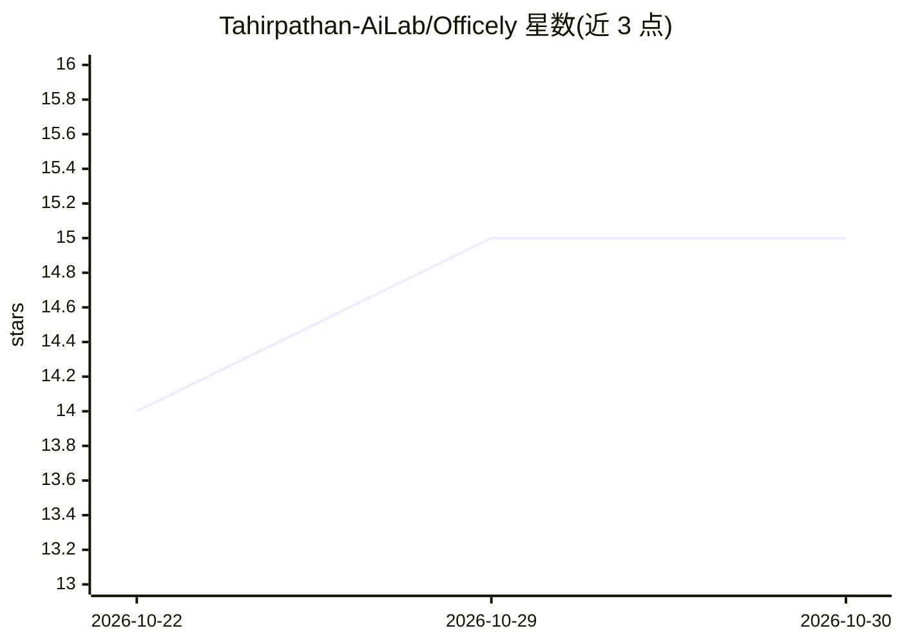

# Tahirpathan-AiLab/Officely

⭐ 15 · HTML · Apache-2.0 · 推送 2026-10-20 · [GitHub](https://github.com/Tahirpathan-AiLab/Officely) · [官网](https://mrtahirpathan.netlify.app/) · 组织维护

**3D 虚拟办公室：四个 AI 机器人 Agent 协作并完成任务**

由 Python 后端（Brain）与 Electron/Three.js 3D 界面（Visualizer）分离构建的多 Agent 办公应用：编排者 Zed 分解目标并分派任务给设计（Evaan）、架构（Athena）、工程（Lumi）三个专职 Agent，产出报告、代码与设计方案。安全机制包括 asyncio.Lock 单次 LLM 推理队列、10 步上限、SQLite 中待批准的敏感操作拦截、外部输入包裹标签的提示注入防护。LLM 后端可配置 Ollama/OpenAI/mock，README 标注处于开发阶段。

## 筛选速览

| 维度 | 判定 | 备注 |
|---|---|---|
| AI 角色 | `ai-native` | 本体是模型或模型工具 |
| 许可风险 | `permissive` | Apache-2.0 |
| 部署形态 | `None` |  |
| 模型依赖 | local-ok | 支持本地模型 |
| 硬件要求 | — | 无带数字的原话,不猜 |
| 安装摩擦 | `low` | 无编译、无系统依赖或容器化 |
| 成熟度 | `idea` | |

## 能力要点

- 四 Agent 分工：编排、设计、架构、工程，任务分解与委派
- 后端强制的敏感操作审批门（delete/git_push/send_email 入 SQLite 等待批准）
- asyncio.Lock 单推理队列防止本地 LLM 的 GPU/RAM 饱和
- Brain 与 3D Visualizer 分离，WebSocket + REST 通信，浏览器不执行 Agent 逻辑

## 适用场景

- 在 3D 界面中观察和指挥多 Agent 完成设计、架构、编码任务
- 通过 CLI 直接测试 Zed→Agent→Tool 任务链
- 用本地 Ollama 运行整套多 Agent 办公系统

## 场景标签

`多智能体` · 领域:Agent 开发

## 证据(README 行号)

> L3: > Autonomous Multi-Agent AI Office with 3D Visualizer & Independent Python Backend Brain.
> L6: - The **Python Backend** handles the orchestrator (Zed), specialized agents (Evaan, Athena, Lumi), tools, permission
> L22: |**Zed**|Orchestrator & Team Lead|`#4cc48a` (Green / Z)|Decomposes goals, plans pipelines, delegates tasks, and syn

## 星数曲线

2026-10-22 14 → 2026-10-30 15（+1）

---
*卡片 v1 · prompt 1.4 · 生成 2026-10-30 · 置信度 high · 依据 README sha `f7263e97d5a1` · [字段定义](../../DATASET.md)*
