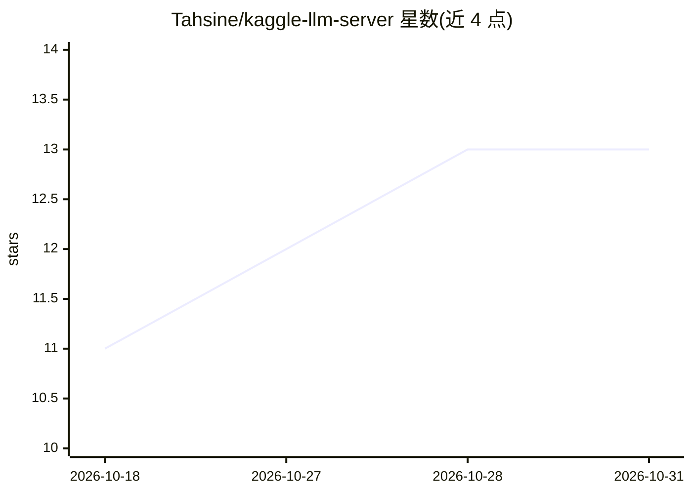

# Tahsine/kaggle-llm-server

⭐ 13 · Jupyter Notebook · 推送 2026-05-24 · [GitHub](https://github.com/Tahsine/kaggle-llm-server) · 个人维护

**在免费 Kaggle GPU 上运行 Qwen3.6-35B 多模态 LLM 服务器的笔记本方案**

由三个 Kaggle notebook 组成的部署方案：下载 Qwen3.6-35B-A3B 量化模型（GGUF，22.4 GB）、编译带 CUDA 支持的 llama.cpp、启动 llama-server 并经 Cloudflare Tunnel 暴露公网 OpenAI 兼容 API（/v1/chat/completions），支持文本与图像输入，以及按请求切换的直接/思考两种模式。附带 chat.py 命令行客户端。限制：Kaggle 免费层每会话最长 12 小时、每周 30 小时 GPU 时间，URL 每次会话变化。

## 筛选速览

| 维度 | 判定 | 备注 |
|---|---|---|
| AI 角色 | `ai-ecosystem` | LLM/agent 周边工具 |
| 许可风险 | `none` | — |
| 部署形态 | `library` | 以包/库形式分发 |
| 模型依赖 | local-ok | 支持本地模型 |
| 硬件要求 | — | 无带数字的原话,不猜 |
| 安装摩擦 | `medium` | 含编译或系统依赖之一 |
| 成熟度 | — | 结构信号不足 |

## 能力要点

- llama.cpp + Cloudflare Tunnel 暴露 OpenAI 兼容 API
- Qwen3.6-35B-A3B 多模态（文本+图像），支持按请求切换思考模式
- 提供预编译公开数据集，可跳过约 45 分钟的初始设置
- Save Version 后台模式可保持服务器在线至 12 小时

## 适用场景

- 没有本地 GPU 时免费运行 35B 多模态模型
- 用任意 OpenAI 兼容客户端（Open WebUI、Chatbox 等）远程调用
- 临时搭建供个人项目调用的 LLM API 端点

## 场景标签

`推理引擎` `多模态` · 领域:感知与多模态

## 证据(README 行号)

> L5: > **Model:** Qwen3.6-35B-A3B · **Quant:** UD-Q4_K_XL (22.4 GB) · **Backend:** llama.cpp · **Tunnel:** Cloudflare
> L16: The server exposes a standard **OpenAI-compatible API** (`/v1/chat/completions`).

## 星数曲线

2026-10-18 11 → 2026-10-31 13（+2）

---
*卡片 v1 · prompt 1.4 · 生成 2026-10-31 · 置信度 mid · 依据 README sha `08420e3fce16` · [字段定义](../../DATASET.md)*
