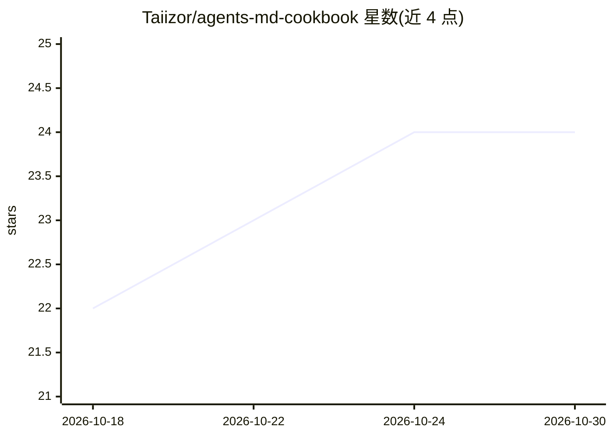

# Taiizor/agents-md-cookbook

⭐ 24 · TypeScript · MIT · 推送 2026-08-08 · [GitHub](https://github.com/Taiizor/agents-md-cookbook) · [官网](https://agents.md) · 个人维护

**AGENTS.md 模板套件：跨工具的编码代理配置模板与迁移/检查工具**

面向使用编码代理（coding agent）的开发者：提供针对 TypeScript/Python/Go/Rust 等 16 种技术栈的可复制 AGENTS.md 模板，附两个 npm CLI——agents-md-migrate 可将现有 CLAUDE.md/.cursorrules/GEMINI.md 转换为单一 AGENTS.md，agents-md-lint 在 CI 中按规则评分并在回退时失败。模板依据 GitHub 2500 仓库研究、ETH Zurich AGENTbench 与 Augment 评测设定长度（60-150 行）与结构。附 24+ 工具的原生/适配/配置读取方式兼容矩阵。

## 筛选速览

| 维度 | 判定 | 备注 |
|---|---|---|
| AI 角色 | `ai-ecosystem` | LLM/agent 周边工具 |
| 许可风险 | `permissive` | MIT |
| 部署形态 | `library` | 以包/库形式分发 |
| 模型依赖 | — | README 未给出锁定关系 |
| 硬件要求 | — | 无带数字的原话,不猜 |
| 安装摩擦 | `medium` | 含编译或系统依赖之一 |
| 成熟度 | — | 结构信号不足 |

## 能力要点

- 16 种技术栈的即用 AGENTS.md 模板
- agents-md-migrate 一条命令从 CLAUDE.md/.cursorrules/GEMINI.md 迁移
- agents-md-lint 在 CI 中对 AGENTS.md 评分检查
- 24+ 编码代理工具的兼容矩阵（NATIVE/ADAPTER/CONFIG）

## 适用场景

- 为我的项目快速接入统一的编码代理配置文件
- 把散落的各工具配置迁移为单一 AGENTS.md
- 在 CI 中持续校验 AGENTS.md 的质量

## 场景标签

`提示工程` · 领域:Agent 开发

## 证据(README 行号)

> L12: Copy a battle-tested `AGENTS.md` into your repo, lint it in CI, and migrate your
> L142: Published to npm so you can run them with `bunx` or `npx` (no install needed):
> L144: - **`agents-md-lint`** — scores an `AGENTS.md` against the evidence-based rules

## 星数曲线

2026-10-18 22 → 2026-10-30 24（+2）

---
*卡片 v1 · prompt 1.4 · 生成 2026-10-27 · 置信度 high · 依据 README sha `0a29df5ceb37` · [字段定义](../../DATASET.md)*
