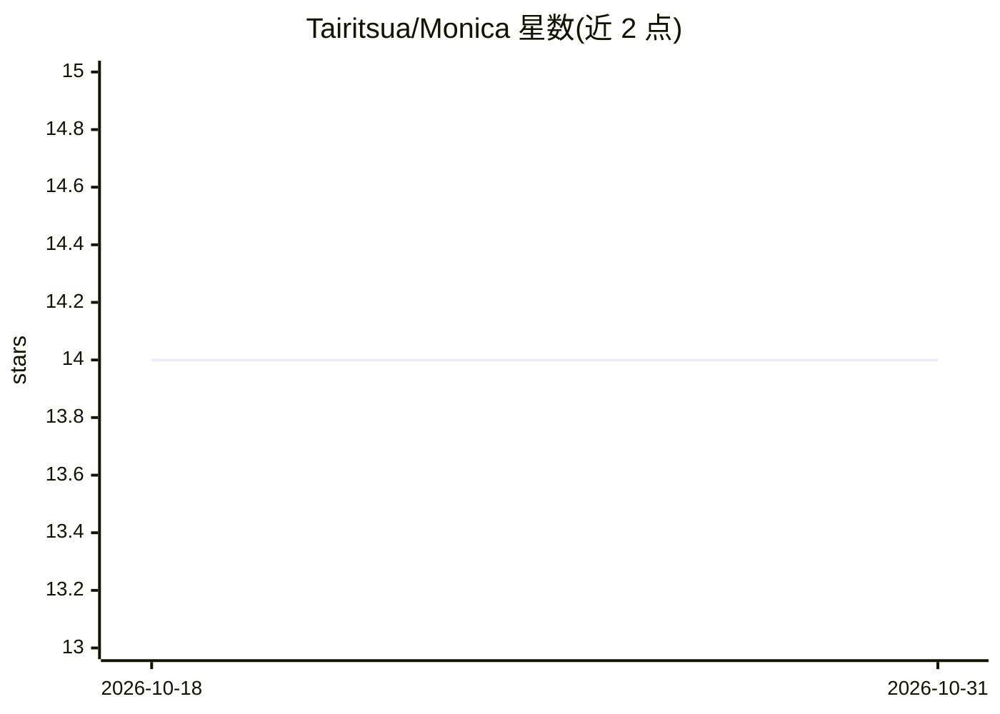

# Tairitsua/Monica

⭐ 14 · C# · MIT · 推送 2026-10-30 · [GitHub](https://github.com/Tairitsua/Monica) · [官网](https://monica.dpdns.org/) · 个人维护 · 中文 README

**面向 agent 驱动开发的模块化 .NET 后端基础设施框架**

Monica 是 .NET 模块化基础设施库集合：通过 AddMonica 回调构建模块依赖图并按确定性阶段应用注册，以 ProjectUnits 词汇（应用服务、实体、仓储、事件、任务等）描述 DDD 应用结构，供开发者与编码 agent 共享类型化词汇。内置 Blazor 运行时界面（模块依赖、任务调度、配置、诊断工作台），并发布 9 个供 coding agent 使用的 Agent Skills。包按 Stable/Integrations/Labs 三级成熟度分层，MIT 许可，接近 1.0 仍允许破坏性架构改动。

## 筛选速览

| 维度 | 判定 | 备注 |
|---|---|---|
| AI 角色 | `ai-ecosystem` | LLM/agent 周边工具 |
| 许可风险 | `permissive` | MIT |
| 部署形态 | `None` |  |
| 模型依赖 | — | README 未给出锁定关系 |
| 硬件要求 | — | 无带数字的原话,不猜 |
| 安装摩擦 | `medium` | 含编译或系统依赖之一 |
| 成熟度 | `idea` | |

## 能力要点

- AddMonica 模块图构建：依赖与环校验、确定性阶段应用注册
- ProjectUnits 类型化架构词汇（11 种角色单元）携带 agent 上下文与需求追溯
- Blazor 运行时面板：JobScheduler、模块诊断、配置与遥测
- skills/ 下 9 个消费者 Agent Skills 供编码 agent 复用

## 适用场景

- C# 后端按需组合基础设施模块（作业调度、仓储、配置等）
- 让编码 agent 按统一架构契约生成结构可预测的代码
- 运行中检查模块依赖图、任务执行与配置状态

## 场景标签

 · 领域:.NET 后端基础设施框架

## 证据(README 行号)

> L14: Monica is modular .NET infrastructure for agent-driven development. Applications can adopt its modules independentl
> L86: The canonical Monica Agent Skills live under `skills/`. Nine consumer skills are the single source of reusable infr

## 星数曲线

2026-10-18 14 → 2026-10-31 14（+0）

---
*卡片 v1 · prompt 1.4 · 生成 2026-10-31 · 置信度 high · 依据 README sha `1de755fc3613` · [字段定义](../../DATASET.md)*
