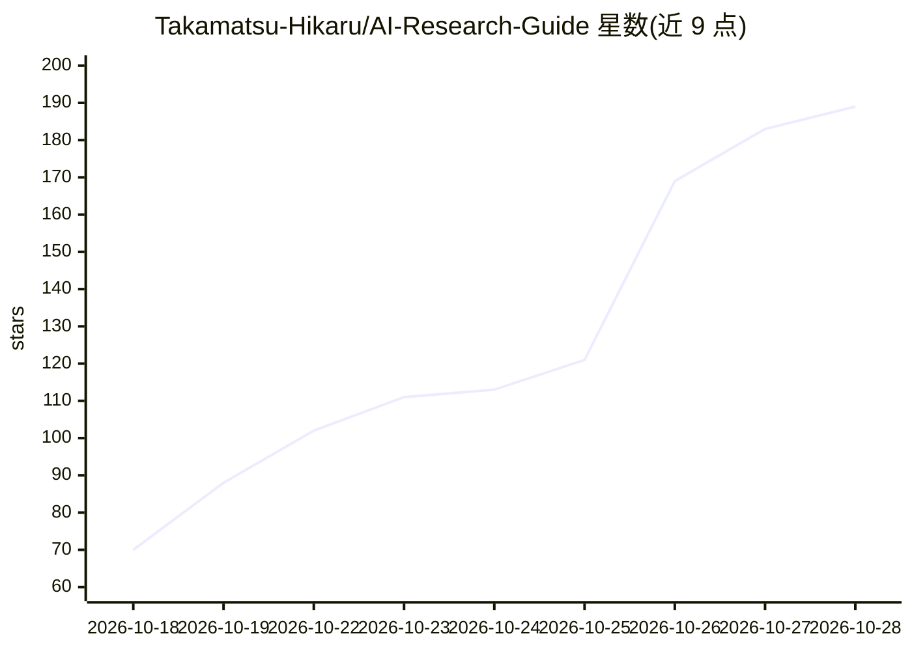

# Takamatsu-Hikaru/AI-Research-Guide

⭐ 193 · JavaScript · 推送 2026-10-18 · [GitHub](https://github.com/Takamatsu-Hikaru/AI-Research-Guide) · [官网](https://takamatsu-hikaru.github.io/AI-Research-Guide/) · 组织维护 · 中文 README

**面向大学新生的 AI 科研入门双语指南与论文卡片库**

由 UESTC AI 社维护的中英双语科研入门指南：包含科研入门问答、学习路线、10 个 AI 方向的简介与术语、带原图的论文卡片（附论文原文及项目链接）、术语与会议速查，以及联系老师、写作汇报等科研实践内容。整理了 OpenEnvision、Lumina、AgentHub 等社区资源。内容以 Markdown 存储，用 Node.js 构建生成静态网站，提供 GitHub Pages、社团版与个人主页版三个入口。

## 筛选速览

| 维度 | 判定 | 备注 |
|---|---|---|
| AI 角色 | `ai-knowledge` | 知识聚合/清单类 |
| 许可风险 | `none` | — |
| 部署形态 | `None` |  |
| 模型依赖 | — | README 未给出锁定关系 |
| 硬件要求 | — | 无带数字的原话,不猜 |
| 安装摩擦 | `low` | 无编译、无系统依赖或容器化 |
| 成熟度 | — | 结构信号不足 |

## 能力要点

- 覆盖 10 个 AI 方向的简介、发展路线、术语与论文卡片
- 中英双语正文，在线阅读支持全文搜索
- 科研入门问答与论文阅读笔记工作流等内容
- 三种发布版式（GitHub Pages/社团版/个人主页版）共用科研正文

## 适用场景

- 刚进大学想了解 AI 和科研的同学查找入门路径
- 按方向浏览代表论文并跳转原文与相关项目
- 查询 AI 术语、会议与期刊信息

## 场景标签

`科研工具` `教程课程` · 领域:学习与行业

## 证据(README 行号)

> L7: 这份指南面向刚进入大学、想了解 AI 和科研的同学。这里有我们对科研入门的回答，也整理了入门项目、各方向的代表论文、课程和工具。联系老师、第一次进组、实验失败，以及和同龄人比较时的焦虑，也在其中。
> L30: 在线阅读包含全文搜索、可展开的科研问答，以及 10 个方向的简介、发展路线、术语和 带原图的论文卡片。每张卡片都附论文原文及相关项目链接。

## 星数曲线

2026-10-18 70 → 2026-10-28 189（+119）

---
*卡片 v1 · prompt 1.4 · 生成 2026-10-23 · 置信度 high · 依据 README sha `1d7d63184c3a` · [字段定义](../../DATASET.md)*
