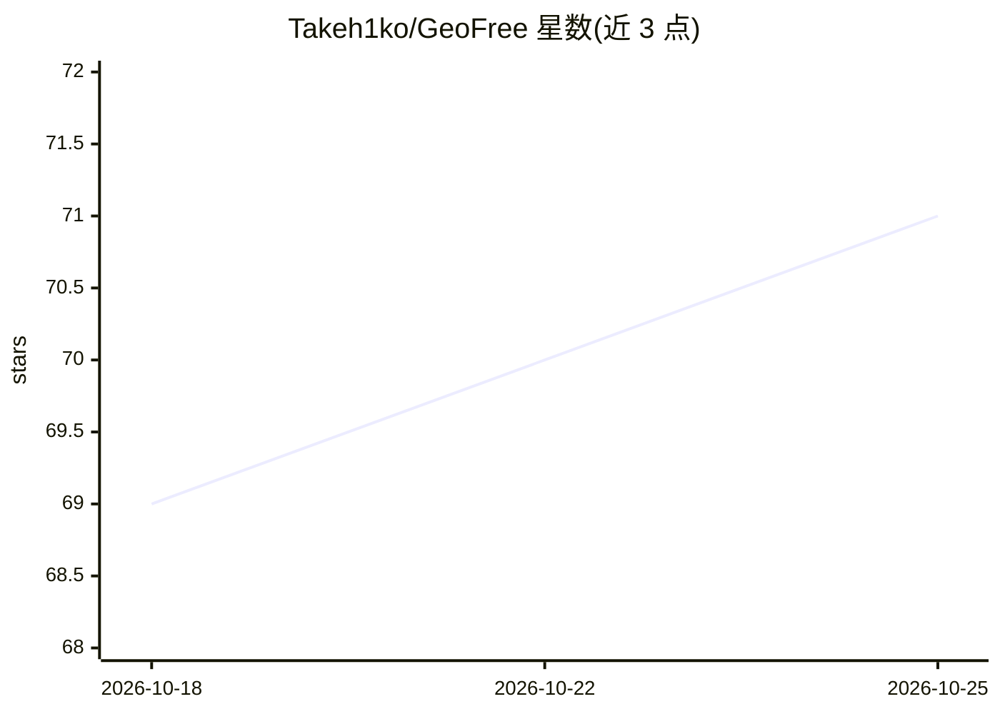

# Takeh1ko/GeoFree

⭐ 71 · Shell · MIT · 推送 2026-07-05 · [GitHub](https://github.com/Takeh1ko/GeoFree) · 个人维护

**修改 hosts 文件解锁 ChatGPT 等 AI 服务的 DNS 脚本**

面向俄罗斯等地区用户的 Windows/Linux/macOS 脚本：通过查询指定 DNS（dns.comss.one）获取可用 IP，把 ChatGPT、Gemini、Claude、Grok、Copilot 及 Netflix/Spotify 等域名以 `<IP> <域名>` 形式写入系统 hosts 文件实现访问，全程不使用 VPN。脚本自动备份原 hosts、去重旧条目、清理 DNS 缓存，支持命令行传参自定义 IP。限制：使用 DoH/自有解析器的应用可能不生效；修改 hosts 需管理员/root 权限。

## 筛选速览

| 维度 | 判定 | 备注 |
|---|---|---|
| AI 角色 | `ai-ecosystem` | LLM/agent 周边工具 |
| 许可风险 | `permissive` | MIT |
| 部署形态 | `None` |  |
| 模型依赖 | — | README 未给出锁定关系 |
| 硬件要求 | — | 无带数字的原话,不猜 |
| 安装摩擦 | `low` | 无编译、无系统依赖或容器化 |
| 成熟度 | — | 结构信号不足 |

## 能力要点

- 自动备份 hosts 并生成带时间戳的回滚文件
- 去除旧记录避免重复，保留注释行
- 覆盖 OpenAI/Google/Anthropic/xAI/Microsoft 等域名清单，可自行扩展
- 支持 Windows .bat 与 Linux/macOS .sh 三平台脚本

## 适用场景

- 无 VPN 环境下访问 ChatGPT、Claude、Gemini 等 AI 服务
- 为流媒体站点（Netflix/Spotify）添加本地解析
- 需要可回滚的 hosts 修改方式

## 场景标签

 · 领域:网络/系统工具

## 证据(README 行号)

> L3: GeoFree — простой (даже для домохозяек) инструмент для обхода блокировки AI-сервисов через системный файл `hosts`.
> L4: Быстрая разблокировка ChatGPT, Claude, Gemini и других AI-сервисов для пользователей из России и др. стран без испол

## 星数曲线

2026-10-18 69 → 2026-10-25 71（+2）

---
*卡片 v1 · prompt 1.4 · 生成 2026-10-24 · 置信度 mid · 依据 README sha `4030235ddab0` · [字段定义](../../DATASET.md)*
