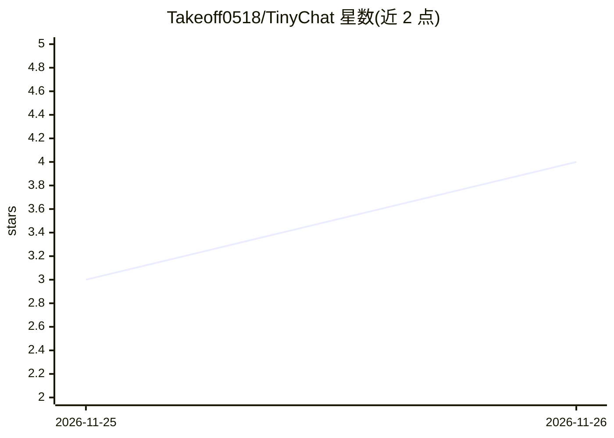

# Takeoff0518/TinyChat

⭐ 4 · Kotlin · MIT · 推送 2026-11-25 · [GitHub](https://github.com/Takeoff0518/TinyChat) · 个人维护 · 中文 README

**Android 端轻量 AI 聊天客户端，接 DeepSeek 及兼容接口**

开源 Android 聊天客户端（约 4 MB 安装包），用于连接 DeepSeek 官方接口以及兼容 OpenAI/Anthropic 协议的第三方大模型服务。提供流式输出、思考过程查看、联网搜索、图片/文件上传、语音输入与朗读、会话管理、Token 用量与费用统计、长图导出及与 DeepSeek 官方客户端格式互通的备份恢复。所有数据仅存于本地，API Key 通过 Android Keystore 加密。用户需自备 API Key，对话按服务商计费。仅支持 Android 8.0 以上和简体中文界面，语音等部分功能仅限 DeepSeek 官方接口。

## 筛选速览

| 维度 | 判定 | 备注 |
|---|---|---|
| AI 角色 | `ai-native` | 本体是模型或模型工具 |
| 许可风险 | `permissive` | MIT |
| 部署形态 | `None` |  |
| 模型依赖 | locked-api |  |
| 硬件要求 | — | 无带数字的原话,不猜 |
| 安装摩擦 | `medium` | 含编译或系统依赖之一 |
| 成熟度 | — | 结构信号不足 |

## 能力要点

- 支持 DeepSeek 官方接口及 OpenAI/Anthropic 兼容协议，可自定义 Base URL
- 流式输出与深度思考过程一键展开
- 聊天记录纯本地存储，API Key 经 Android Keystore 加密
- 备份文件与 DeepSeek 官方客户端格式双向兼容

## 适用场景

- 在手机上用自备 API Key 与 DeepSeek 或第三方大模型对话
- 管理多个服务商与模型，统计每轮 Token 消耗与花费
- 在 DeepSeek 官方客户端与本应用之间迁移聊天记录

## 场景标签

`聊天机器人` `AI 助手` · 领域:对话与助手

## 证据(README 行号)

> L12: TinyChat 是一款开源的 Android 聊天客户端，用来连接 DeepSeek 官方接口，以及其他兼容 OpenAI 或 Anthropic 接口的大模型。它的界面贴近官方客户端的操作习惯，轻巧纯净，且**所有数据都只保存
> L30: 1. **需要自备 API Key**：应用本身不包含任何 Key，也不提供代充或共享账号服务。你可以前往 DeepSeek 开放平台 申请，或使用手头任意兼容 OpenAI 或 Anthropic 格式的服务商接口。

## 星数曲线

2026-11-25 3 → 2026-11-26 4（+1）

---
*卡片 v1 · prompt 1.4 · 生成 2026-11-24 · 置信度 high · 依据 README sha `4502c0c7238d` · [字段定义](../../DATASET.md)*
