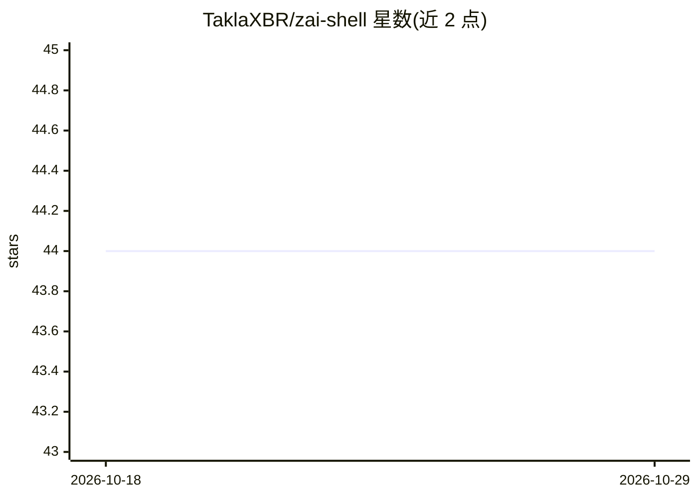

# TaklaXBR/zai-shell

⭐ 44 · Python · AGPL-3.0 · 推送 2026-05-19 · [GitHub](https://github.com/TaklaXBR/zai-shell) · 个人维护

**终端自主系统管理 AI Agent：把自然语言意图变成已验证的系统操作**

用 Python 编写的跨平台（Windows/Linux/Mac）终端 SysOps Agent：将自然语言任务翻译为系统命令并执行，`--auto` 模式下自主循环（读取输出、纠错、重试）直至任务完成。默认通过 Google Generative AI SDK 接入 Gemini，`switch offline` 可下载 Microsoft Phi-2 全离线运行。安全机制包括文件修改自动备份与 `undo` 一键回滚、Sentinel 1.5 风险拦截（含 Prompt Injection 检测）、`--safe` 逐步授权。另提供 fixer/eco/lightning/normal 四种模式、CPU 阈值监控（`--watch`/`--force` 自愈）、截图识错，以及端到端加密的 P2P 终端共享。压力测试报告 65.5% 存活率（57/87 场景）。收集匿名遥测数据，可 `telemetry off` 关闭。

## 筛选速览

| 维度 | 判定 | 备注 |
|---|---|---|
| AI 角色 | `ai-native` | 本体是模型或模型工具 |
| 许可风险 | `viral` | AGPL-3.0 |
| 部署形态 | `library` | 以包/库形式分发 |
| 模型依赖 | — | README 未给出锁定关系 |
| 硬件要求 | — | 无带数字的原话,不猜 |
| 安装摩擦 | `low` | 无编译、无系统依赖或容器化 |
| 成熟度 | — | 结构信号不足 |

## 能力要点

- `--auto` 自主循环：执行、读输出、纠错直至任务完成
- Sentinel 1.5 风险拦截与 Prompt Injection 检测，文件修改可 `undo` 回滚
- `switch offline` 本地运行 Microsoft Phi-2，全程离线
- E2E 加密 P2P 终端共享（share start/connect）

## 适用场景

- 让 AI 代理在终端里自主完成系统修复与运维任务
- 设置 `--watch --force` 让系统在 CPU 超阈值时自愈
- 不装远程桌面软件，通过 P2P 加密通道远程修朋友的电脑

## 场景标签

 · 领域:系统运维/终端工具

## 证据(README 行号)

> L13: ZAI Shell is an **autonomous SysOps agent** designed to navigate, repair, and secure complex environments. It trans
> L18: Don't just give ZAI a command; give it a **mission**. By appending the `--auto` flag, ZAI Shell transitions into a 

## 星数曲线

2026-10-18 44 → 2026-10-29 44（+0）

---
*卡片 v1 · prompt 1.4 · 生成 2026-10-25 · 置信度 high · 依据 README sha `6139a538dbc2` · [字段定义](../../DATASET.md)*
