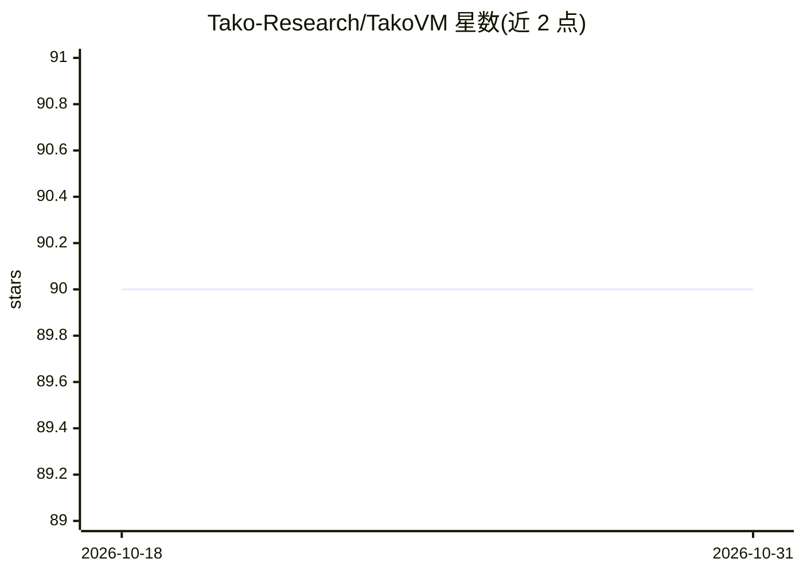

# Tako-Research/TakoVM

⭐ 90 · Python · Apache-2.0 · 推送 2026-10-27 · [GitHub](https://github.com/Tako-Research/TakoVM) · [官网](https://tako-research.github.io/TakoVM/) · 组织维护

**为 AI agent 提供安全代码执行与文件系统的自托管平台**

面向部署 agent 的团队的自托管代码执行基础设施：每个任务在独立的临时 Docker 容器中运行，默认经 gVisor 用户态内核隔离，内置任务队列、自动重试、幂等键、执行历史持久化（PostgreSQL）与重放/分叉调试 API，并默认断网、支持按任务类型的网络白名单。通过 pip 安装、REST API 与 Python SDK 交付，需本机 Docker 与 Python 3.10+。当前每个容器单次使用，持久化工作区在路线图中。用于执行不受信任的、常为 AI 生成的代码。

## 筛选速览

| 维度 | 判定 | 备注 |
|---|---|---|
| AI 角色 | `ai-ecosystem` | LLM/agent 周边工具 |
| 许可风险 | `permissive` | Apache-2.0 |
| 部署形态 | `library` | 以包/库形式分发 |
| 模型依赖 | — | README 未给出锁定关系 |
| 硬件要求 | — | 无带数字的原话,不猜 |
| 安装摩擦 | `low` | 无编译、无系统依赖或容器化 |
| 成熟度 | — | 结构信号不足 |

## 能力要点

- 每任务独立 Docker 容器 + gVisor 用户态内核隔离，默认拒绝启动而非降级
- 内置任务队列、自动重试、幂等键与执行历史（stdout/stderr/计时/产物）
- 重放/分叉 API 支持用相同代码与输入重跑历史任务
- 默认无网络（--network=none），支持按任务类型的网络白名单

## 适用场景

- 让 agent 在隔离沙箱中执行不受信任的 AI 生成代码
- 自托管代码执行服务，避免按次付费的沙箱云服务
- 调试时重放历史执行任务的完整输入与输出

## 场景标签

 · 领域:AI 基础设施/代码执行沙箱

## 证据(README 行号)

> L11: **A secure file system for your agents to execute code.** Every job runs in its own
> L3:  File system and python execution for your agents. Job queues and Docker isolation built-in. Used by teams deploying
> L84: Tako VM runs untrusted, often AI-generated, code, so isolation is the core of the project. It uses layered defenses

## 星数曲线

2026-10-18 90 → 2026-10-31 90（+0）

---
*卡片 v1 · prompt 1.4 · 生成 2026-10-23 · 置信度 high · 依据 README sha `e5334bad5d78` · [字段定义](../../DATASET.md)*
