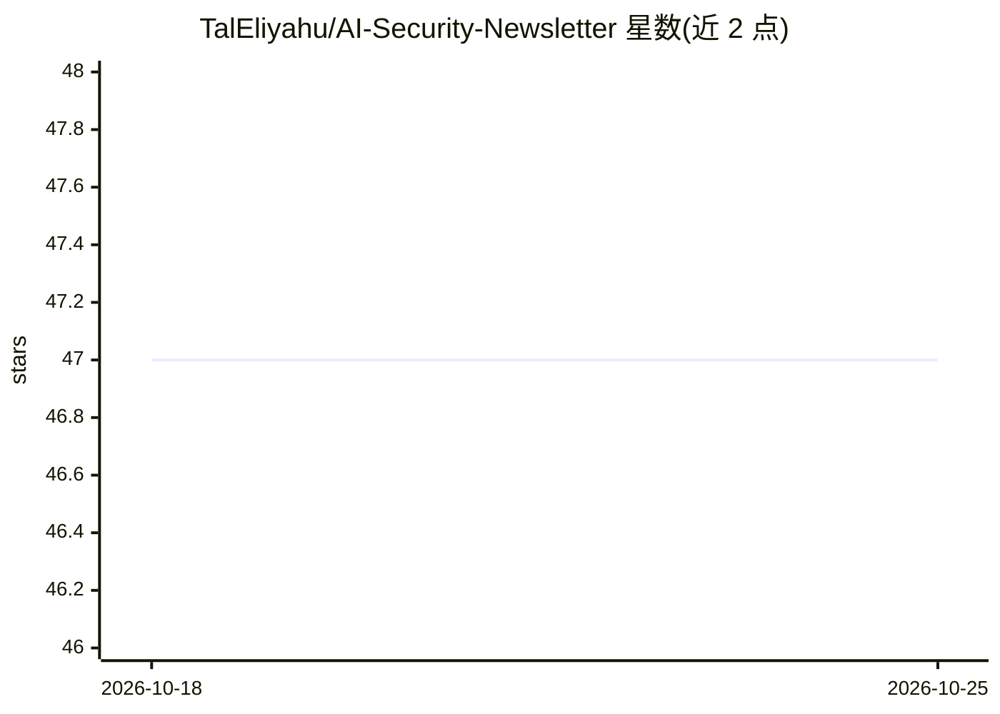

# TalEliyahu/AI-Security-Newsletter

⭐ 47 · 推送 2026-06-28 · [GitHub](https://github.com/TalEliyahu/AI-Security-Newsletter) · [官网](https://www.linkedin.com/newsletters/adversarial-ai-digest-7298813894498598912/) · 组织维护

**AI 安全月度简报：聚合研究、报告、CVE、工具与会议资讯**

月度发布的 AI 安全英文简报（AISecHub 社区关联，附赞助商位）：每期分栏目汇总安全洞察摘要（如 agentic AI 失败模式、提示注入、供应链攻击）、带星标的工具与资源清单（如 MCP 安全工具、LLM 安全代理、红队平台）、行业报告（OWASP、CSA、NSA 等）、AI 相关 CVE 条目、会议日程与研究论文链接。面向安全研究与从业者做情报聚合，本身不含可安装代码。

## 筛选速览

| 维度 | 判定 | 备注 |
|---|---|---|
| AI 角色 | `ai-knowledge` | 知识聚合/清单类 |
| 许可风险 | `none` | — |
| 部署形态 | `None` |  |
| 模型依赖 | — | README 未给出锁定关系 |
| 硬件要求 | — | 无带数字的原话,不猜 |
| 安装摩擦 | `low` | 无编译、无系统依赖或容器化 |
| 成熟度 | — | 结构信号不足 |

## 能力要点

- 分栏目结构：Insights / Tools / Reports / CVEs / Conferences / Research
- 收录带星标数据的 AI 安全开源工具条目
- 汇编 OWASP、CSA、NSA、NCSC 等机构的安全报告
- 跟踪 AI 基础设施相关 CVE 条目（含严重度评分）

## 适用场景

- 安全研究者按月跟踪 AI 安全事件与研究动态
- 安全团队从工具清单中发现 AI 安全防护类开源项目
- 了解 AI 安全面向的会议日程与论文方向

## 场景标签

`精选清单` `网络安全` · 领域:学习与行业

## 证据(README 行号)

> L1: # AI Security Newsletter - June 2026
> L3: A digest of AI security research, insights, reports, upcoming events, and tools & resources. Follow the AISecHub com

## 星数曲线

2026-10-18 47 → 2026-10-25 47（+0）

---
*卡片 v1 · prompt 1.4 · 生成 2026-10-25 · 置信度 high · 依据 README sha `78e11486b7e4` · [字段定义](../../DATASET.md)*
