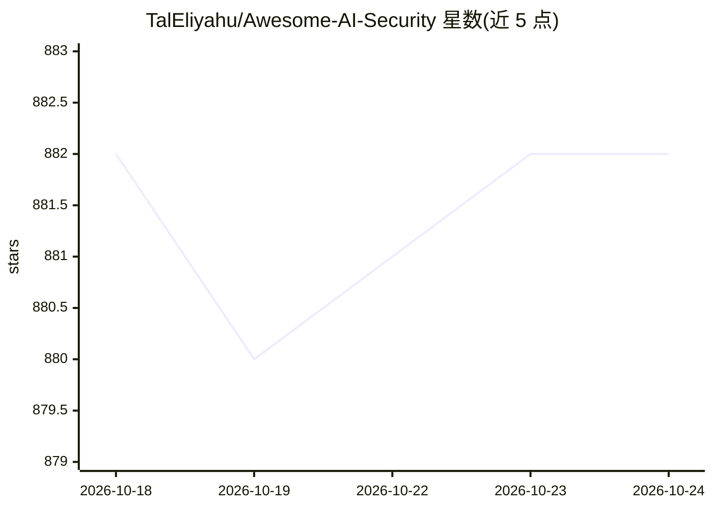

# TalEliyahu/Awesome-AI-Security

⭐ 882 · MIT · 推送 2026-07-18 · [GitHub](https://github.com/TalEliyahu/Awesome-AI-Security) · [官网](https://www.awesomeaisecurity.com/) · 组织维护

**AI 安全资源策展清单：框架、指南与工具的聚合目录**

由 AISecHub 维护、InnovGuard 支持的 AI 安全资源聚合清单：收录治理框架（NIST AI RMF、ISO/IEC 42001）、控制标准（OWASP AISVS、CSA AICM）、红队指南、威胁建模方法、政策模板与自评估工具包，并按收录标准（220+ stars、近 12 个月维护、≥3 贡献者）收录开源工具，覆盖凭据隔离、提示注入检测、护栏、模型文件扫描等类别。面向需要构建或审计 AI 系统安全的企业与安全从业者，本身为目录型资源，无可运行代码。

## 筛选速览

| 维度 | 判定 | 备注 |
|---|---|---|
| AI 角色 | `ai-knowledge` | 知识聚合/清单类 |
| 许可风险 | `permissive` | MIT |
| 部署形态 | `None` |  |
| 模型依赖 | — | README 未给出锁定关系 |
| 硬件要求 | — | 无带数字的原话,不猜 |
| 安装摩擦 | `medium` | 含编译或系统依赖之一 |
| 成熟度 | — | 结构信号不足 |

## 能力要点

- 覆盖治理框架、控制标准、红队与威胁建模等多类资源
- 工具收录有明确标准（220+ stars、12 个月内维护、≥3 贡献者）
- 工具按安全功能分类（凭据隔离/提示注入检测/护栏/模型文件扫描）

## 适用场景

- 为组织的 AI 系统寻找适用的安全框架与合规标准
- 做 AI 红队测试或威胁建模时查找指南与工具
- 选型 LLM 应用防护工具（护栏、提示注入检测）

## 场景标签

`精选清单` `网络安全` · 领域:学习与行业

## 证据(README 行号)

> L1: # Awesome AI Security Awesome
> L2: Curated resources, research, and tools for securing AI systems. Managed by AISecHub. **Powered by:** InnovGuard
> L125: *Inclusion criteria (open-source tools): must have **220+ GitHub stars**, **active maintenance in the last 12 mont

## 星数曲线

2026-10-18 882 → 2026-10-24 882（+0）

---
*卡片 v1 · prompt 1.4 · 生成 2026-10-21 · 置信度 high · 依据 README sha `04dcd2b91ed3` · [字段定义](../../DATASET.md)*
