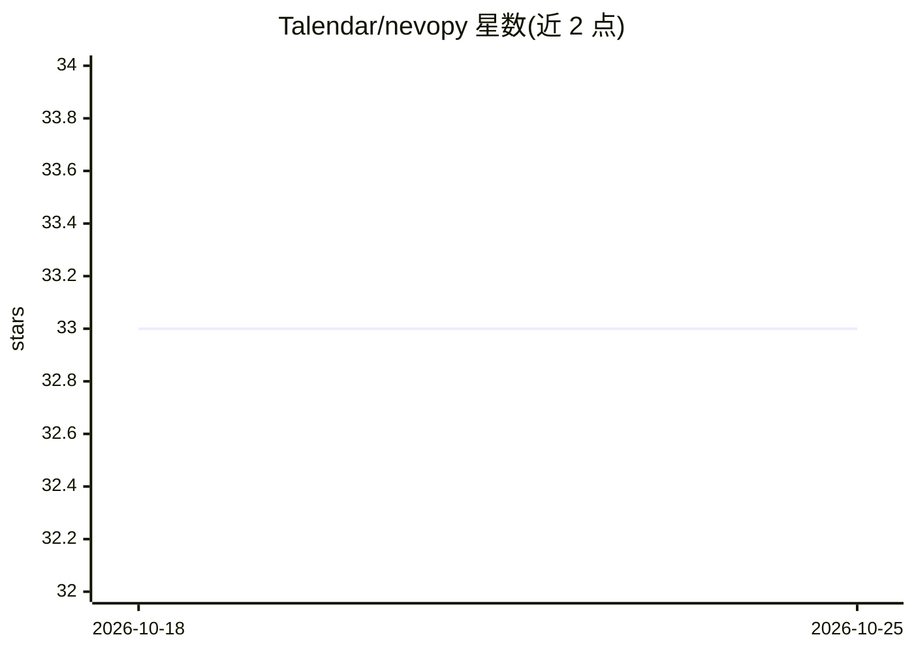

# Talendar/nevopy

⭐ 33 · Python · MIT · 推送 2026-02-25 · [GitHub](https://github.com/Talendar/nevopy) · 个人维护

**Python 神经进化框架：用进化算法生成神经网络**

开源的 Python 神经进化框架，提供面向研究者和爱好者的 API，通过进化算法解决机器学习问题。实现两种算法：NEAT（通过结构复杂化进化神经网络）与固定拓扑的神经进化（支持 TensorFlow 与深度神经网络）。针对分布式计算做了优化，并提供工具帮助用户实现自己的算法。以 pip 包形式安装，附 XOR、Flappy Bird、Lunar Lander、Cart Pole 等示例与 Read the Docs 文档，可按 Bibtex 条目引用。

## 筛选速览

| 维度 | 判定 | 备注 |
|---|---|---|
| AI 角色 | `ai-native` | 本体是模型或模型工具 |
| 许可风险 | `permissive` | MIT |
| 部署形态 | `library` | 以包/库形式分发 |
| 模型依赖 | — | README 未给出锁定关系 |
| 硬件要求 | — | 无带数字的原话,不猜 |
| 安装摩擦 | `low` | 无编译、无系统依赖或容器化 |
| 成熟度 | — | 结构信号不足 |

## 能力要点

- 实现 NEAT 与固定拓扑神经进化两种算法
- 固定拓扑路径支持 TensorFlow 与深度神经网络
- 针对分布式计算优化
- 提供实现自定义神经进化算法的工具

## 适用场景

- 用 NEAT 等进化算法进化神经网络解决强化学习任务
- 研究者快速实验神经进化算法并扩展自己的变体
- 分布式环境下运行神经进化训练

## 场景标签

`强化学习` `模型训练` · 领域:训练与推理

## 证据(README 行号)

> L10: *NEvoPy* is an open source neuroevolution framework for Python. It provides a
> L17:  * **NEAT** (NeuroEvolution of Augmenting Topologies), a powerful method by
> L19:  * the standard fixed-topology approach to neuroevolution, with support to

## 星数曲线

2026-10-18 33 → 2026-10-25 33（+0）

---
*卡片 v1 · prompt 1.4 · 生成 2026-10-25 · 置信度 high · 依据 README sha `4a350198207b` · [字段定义](../../DATASET.md)*
