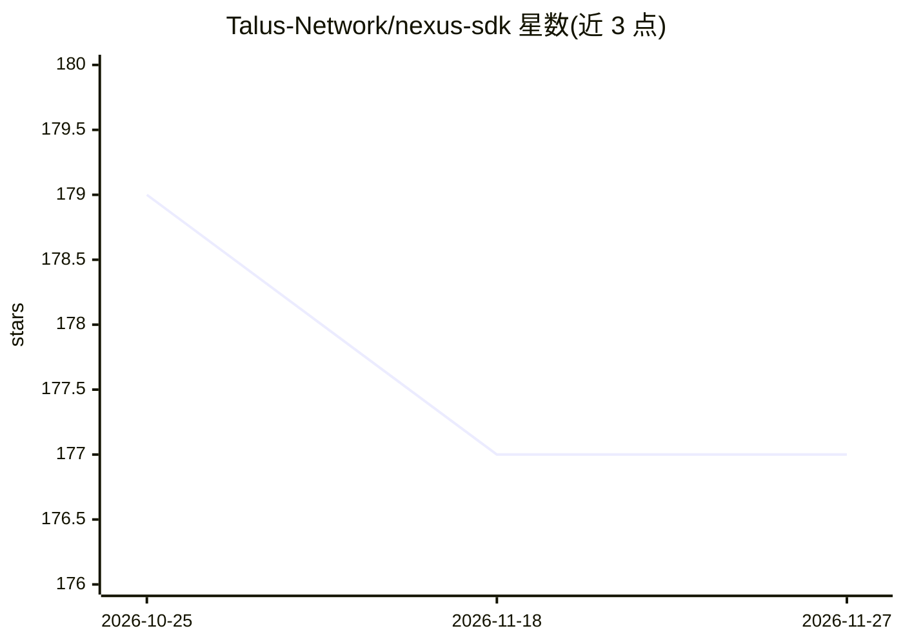

# Talus-Network/nexus-sdk

⭐ 177 · Rust · Apache-2.0 · 推送 2026-11-25 · [GitHub](https://github.com/Talus-Network/nexus-sdk) · [官网](https://docs.talus.network) · 组织维护

**面向开发者的 Nexus Agentic Workflow Engine 工具集 SDK**

Nexus SDK 是一组帮助开发者基于 Nexus（Agentic Workflow Engine）构建 Talus agents 与 Talus tools 的工具集合，仓库包含 nexus-cli、nexus-sdk、nexus-toolkit-rust、nexus-walrus 及标准 Nexus Tools 等开源包。安装方式覆盖 Homebrew、AUR、cargo-binstall 与 Cargo 源码编译。CLI 支持 Task/Schedule/Occurrence 的定时任务模型、跨交易组合任务、Move 单元测试（本地 Sui VM 运行已发布 Nexus 字节码）以及 TAP 脚手架生成。

## 筛选速览

| 维度 | 判定 | 备注 |
|---|---|---|
| AI 角色 | `ai-ecosystem` | LLM/agent 周边工具 |
| 许可风险 | `permissive` | Apache-2.0 |
| 部署形态 | `library` | 以包/库形式分发 |
| 模型依赖 | — | README 未给出锁定关系 |
| 硬件要求 | — | 无带数字的原话,不猜 |
| 安装摩擦 | `low` | 无编译、无系统依赖或容器化 |
| 成熟度 | — | 结构信号不足 |

## 能力要点

- 包含 nexus-cli、nexus-sdk、nexus-toolkit-rust、nexus-walrus 等多个开源包
- Task→Schedule→Occurrence 定时任务模型与原子调度命令
- nexus tap test 在本地 Sui VM 运行 Move 单元测试
- 提供 Homebrew/AUR/cargo-binstall/Cargo 多种安装途径

## 适用场景

- 为 Nexus 工作流引擎开发 Talus agent 或工具
- 在链上调度与检查定时任务及其执行记录
- 对已发布的 Nexus 字节码运行本地 Move 测试

## 场景标签

`工作流自动化` `Agent 框架` · 领域:Agent 开发

## 证据(README 行号)

> L8: The **Nexus SDK** is a collection of tools that simplifies building with **Nexus**, the Agentic Workflow Engine. Dev
> L83: TAP authors can run Move unit tests against published Nexus bytecode with
> L85: and developer test extensions in one local Sui VM. See the canonical

## 星数曲线

2026-10-25 179 → 2026-11-27 177（-2）

---
*卡片 v1 · prompt 1.4 · 生成 2026-11-26 · 置信度 high · 依据 README sha `a6ea4caacfeb` · [字段定义](../../DATASET.md)*
