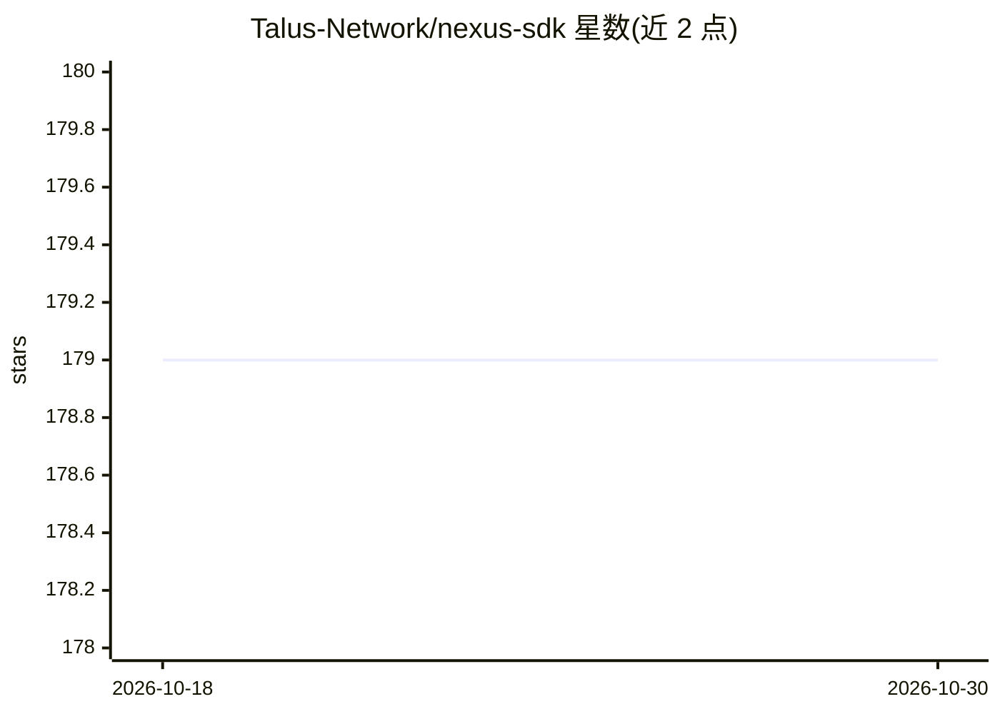

# Talus-Network/nexus-sdk

⭐ 179 · Rust · Apache-2.0 · 推送 2026-10-29 · [GitHub](https://github.com/Talus-Network/nexus-sdk) · [官网](https://docs.talus.network) · 组织维护

**构建 Talus 链上 agent 的 SDK/CLI 工具集**

Talus Network 维护的 Nexus SDK 开源工具集，简化开发者基于 Nexus（Agentic Workflow Engine）创建 Talus agents 与 Talus tools。仓库包含 nexus-cli、nexus-sdk、nexus-toolkit-rust、nexus-walrus 及标准 Nexus Tools 等包。CLI 提供 Homebrew、AUR、cargo-binstall、cargo 源码编译四种安装途径；支持 Task→Schedule→Occurrence 调度模型、TAP 脚手架生成与在本地 Sui VM 中对已发布 Nexus 字节码运行 Move 单元测试。开发流程使用 just 命令运行器。

## 筛选速览

| 维度 | 判定 | 备注 |
|---|---|---|
| AI 角色 | `ai-ecosystem` | LLM/agent 周边工具 |
| 许可风险 | `permissive` | Apache-2.0 |
| 部署形态 | `library` | 以包/库形式分发 |
| 模型依赖 | — | README 未给出锁定关系 |
| 硬件要求 | — | 无带数字的原话,不猜 |
| 安装摩擦 | `low` | 无编译、无系统依赖或容器化 |
| 成熟度 | — | 结构信号不足 |

## 能力要点

- 多包仓库：nexus-cli / nexus-sdk / nexus-toolkit-rust / nexus-walrus 等
- Task→Schedule→Occurrence 调度模型，Schedule 原子应用
- nexus tap test 在本地 Sui VM 运行针对已发布字节码的 Move 单元测试
- nexus tap scaffold 生成标准 TAP 项目结构

## 适用场景

- 在 Sui/Talus 链上开发和管理 agent 工作流任务
- 为 Talus agents 编写与测试 TAP（Tool Access Policy）
- 通过命令行调度和查询 Task 的 occurrence 记录

## 场景标签

`Agent 框架` · 领域:Agent 开发

## 证据(README 行号)

> L8: The **Nexus SDK** is a collection of tools that simplifies building with **Nexus**, the Agentic Workflow Engine. Dev
> L10: This repository includes open-source Nexus packages:

## 星数曲线

2026-10-18 179 → 2026-10-30 179（+0）

---
*卡片 v1 · prompt 1.4 · 生成 2026-10-22 · 置信度 mid · 依据 README sha `079873c52cb8` · [字段定义](../../DATASET.md)*
