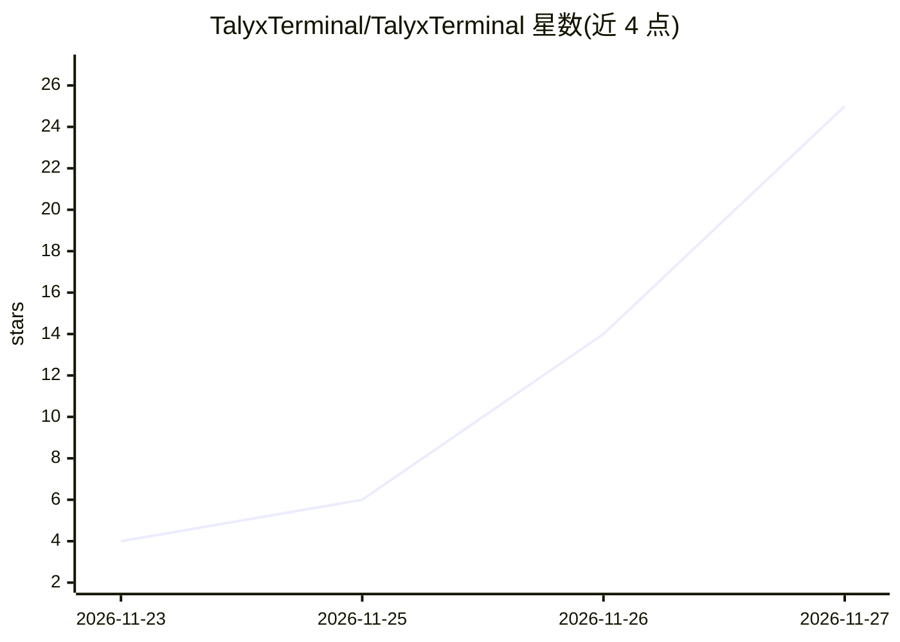

# TalyxTerminal/TalyxTerminal

⭐ 25 · Python · Apache-2.0 · 推送 2026-11-25 · [GitHub](https://github.com/TalyxTerminal/TalyxTerminal) · 个人维护 · 中文 README

**本地运行的模块化金融终端：图表、量化研究与 AI Agent**

运行在用户本机的开源金融终端，由平台加模块构成：Chart 提供多种图表类型与 Python 编写的指标；Quant 支持因子计算、机器学习信号与基于 Nautilus 引擎的回测；Agent 模块可连接用户选择的模型，执行取数、画图、回测等操作并按权限确认；Market 模块统一管理美股、A股、港股与加密货币数据源，数据本地存储可离线读取。外部 AI 工具可通过 MCP 接入。目前支持 Windows x64。

## 筛选速览

| 维度 | 判定 | 备注 |
|---|---|---|
| AI 角色 | `ai-enhanced` | 去掉 AI 部分产品仍成立 |
| 许可风险 | `permissive` | Apache-2.0 |
| 部署形态 | `desktop` | 安装包/桌面程序 |
| 模型依赖 | — | README 未给出锁定关系 |
| 硬件要求 | — | 无带数字的原话,不猜 |
| 安装摩擦 | `low` | 无编译、无系统依赖或容器化 |
| 成熟度 | — | 结构信号不足 |

## 能力要点

- 模块化架构：官方与第三方模块通过同一契约协作
- AI Agent 与用户共用界面操作，外部工具可经 MCP 接入
- 指标用 Python 编写，可在图表上直接调用 scikit-learn、PyTorch 模型
- 数据经交易所官方 API 与免费源获取，本地存储，不经项目服务器

## 适用场景

- 在同一工作区看盘、写指标并筛选标的
- 做因子研究与 walk-forward 回测
- 让 AI Agent 代为取数、建图或跑回测
- 本地保存加密货币与股票历史数据离线研究

## 场景标签

`金融量化` · 领域:学习与行业

## 证据(README 行号)

> L22: **A financial terminal that runs on your own computer, and is open all the way down.**
> L34: - **People and AI use the same actions.** Whatever you can do in the interface, the AI can do too, and external AI 
> L56: **Agent: an AI that understands your workspace.** Connect the model you choose; it works with the same tools you do

## 星数曲线

2026-11-23 4 → 2026-11-27 25（+21）

---
*卡片 v1 · prompt 1.4 · 生成 2026-11-23 · 置信度 high · 依据 README sha `9224c2b03412` · [字段定义](../../DATASET.md)*
