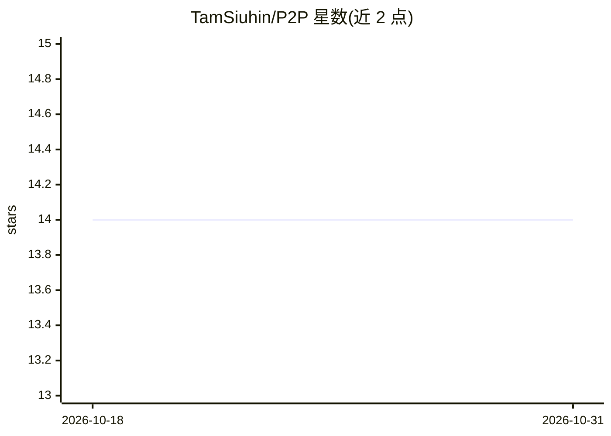

# TamSiuhin/P2P

⭐ 14 · Python · Apache-2.0 · 推送 2025-12-22 · [GitHub](https://github.com/TamSiuhin/P2P) · [官网](https://zhaoxuan.info/p2p.github.io/) · 组织维护

**超网络即时个性化 LLM 适配（P2P）论文参考实现**

论文 Instant Personalized LLM Adaptation via Hypernetwork 的参考代码：训练一个超网络，读取用户历史文本生成的用户嵌入，为每个用户即时生成 PEFT（LoRA 形式）适配参数，实现无需逐用户微调的个性化 LLM。面向科研复现：提供基于 uv 的安装流程、Hugging Face 数据下载、vllm Docker 服务嵌入模型的训练脚本（单卡 80G A100 实验），并含 RAG/PAG/全历史提示/MT-LoRA/OPPU 等基线的训练与评测脚本。

## 筛选速览

| 维度 | 判定 | 备注 |
|---|---|---|
| AI 角色 | `ai-native` | 本体是模型或模型工具 |
| 许可风险 | `permissive` | Apache-2.0 |
| 部署形态 | `self-host` | docker 或自建部署 |
| 模型依赖 | local-ok | 支持本地模型 |
| 硬件要求 | — | 无带数字的原话,不猜 |
| 安装摩擦 | `low` | 无编译、无系统依赖或容器化 |
| 成熟度 | — | 结构信号不足 |

## 能力要点

- 超网络按用户嵌入即时生成 PEFT 个性化适配参数
- 数据处理与训练/评测脚本齐备（Qwen 系列）
- 基线覆盖 RAG、PAG、All-History、MT-LoRA、OPPU

## 适用场景

- 复现论文实验或对比个性化 LLM 基线
- 研究超网络驱动的免训练个性化适配方法
- 基于 Text-to-LoRA 代码库二次开发 PEFT 生成方法

## 场景标签

`科研工具` `模型训练` `模型评测` · 领域:评测与运维

## 证据(README 行号)

> L7:  A reference implementation of Profile-to-PEFT (P2P).
> L43: After setting up the embedding model api, we then run the following script for a hypernetwork training using one GP

## 星数曲线

2026-10-18 14 → 2026-10-31 14（+0）

---
*卡片 v1 · prompt 1.4 · 生成 2026-10-31 · 置信度 mid · 依据 README sha `c6e720dea3a4` · [字段定义](../../DATASET.md)*
