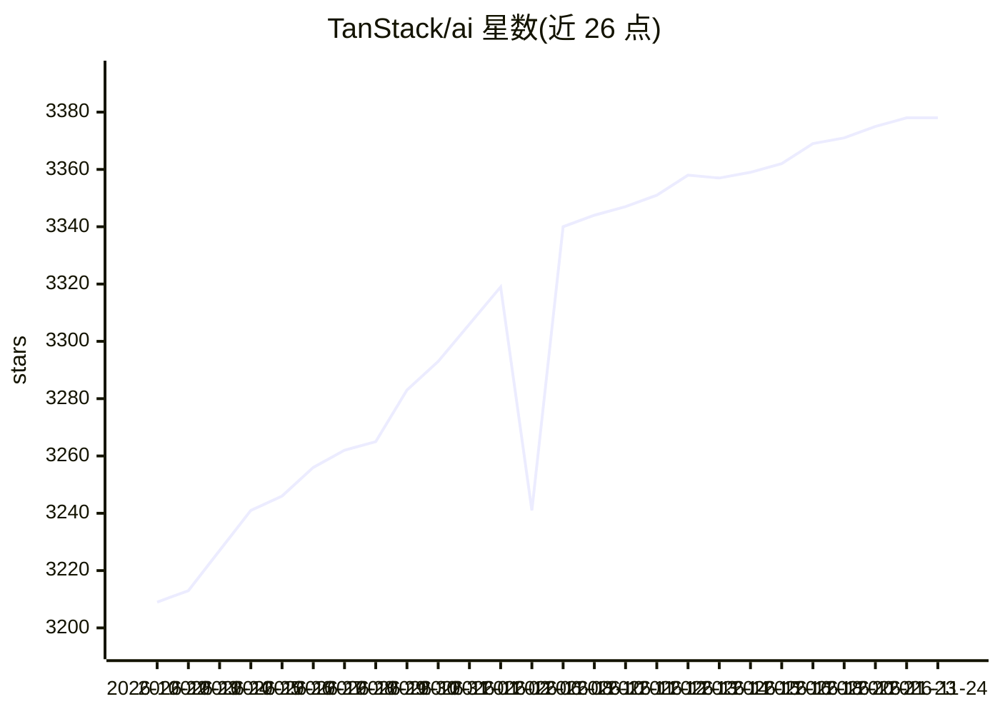

# TanStack/ai

⭐ 3,378 · TypeScript · MIT · 推送 2026-11-22 · [GitHub](https://github.com/TanStack/ai) · [官网](https://tanstack.com/ai/latest) · 组织维护

**面向 TypeScript 开发者的类型安全多供应商 LLM 应用 SDK**

TanStack AI 是一组 TypeScript 包，提供流式聊天、工具调用、结构化输出、实时语音、图像/音频/视频生成与转写等能力的统一抽象。核心包 @tanstack/ai 配合官方 provider 适配器（OpenRouter、OpenAI、Anthropic、Gemini、Ollama、Groq 等）与框架包（React/Solid/Vue/Svelte/Preact hooks 及无头客户端）使用；适配器按 activity tree-shake，支持运行时切换供应商、中间件与 OpenTelemetry 追踪。通过 pnpm/npm 安装，文档以网站形式提供。

## 筛选速览

| 维度 | 判定 | 备注 |
|---|---|---|
| AI 角色 | `ai-ecosystem` | LLM/agent 周边工具 |
| 许可风险 | `permissive` | MIT |
| 部署形态 | `library` | 以包/库形式分发 |
| 模型依赖 | local-ok | 支持本地模型 |
| 硬件要求 | — | 无带数字的原话,不猜 |
| 安装摩擦 | `low` | 无编译、无系统依赖或容器化 |
| 成熟度 | — | 结构信号不足 |

## 能力要点

- 类型安全的 toolDefinition() 契约，服务端/客户端共享实现
- 官方适配器覆盖 16 个 provider 包，可 tree-shake 与运行时切换
- React/Solid/Vue/Svelte/Preact 框架 hooks 与无头 UI 组件
- Code Mode：模型在隔离沙箱中编写并执行 TypeScript 编排工具

## 适用场景

- 在前端应用中构建流式聊天与工具调用界面
- 通过 OpenRouter 单一 API key 接入多个模型
- 接入本地 Ollama 模型构建 AI 应用
- 为多模态生成（图像/语音/视频）统一客户端模式

## 场景标签

`模型网关` · 领域:Agent 开发

## 证据(README 行号)

> L37: Type-safe, provider-agnostic TypeScript SDK for building streaming chat,
> L41: TanStack AI is built from composable activities and provider adapters. Use one
> L182: ## Providers

## 星数曲线

2026-10-22 3,209 → 2026-11-24 3,378（+169）

---
*卡片 v1 · prompt 1.4 · 生成 2026-11-23 · 置信度 high · 依据 README sha `94e875a7a47e` · [字段定义](../../DATASET.md)*
