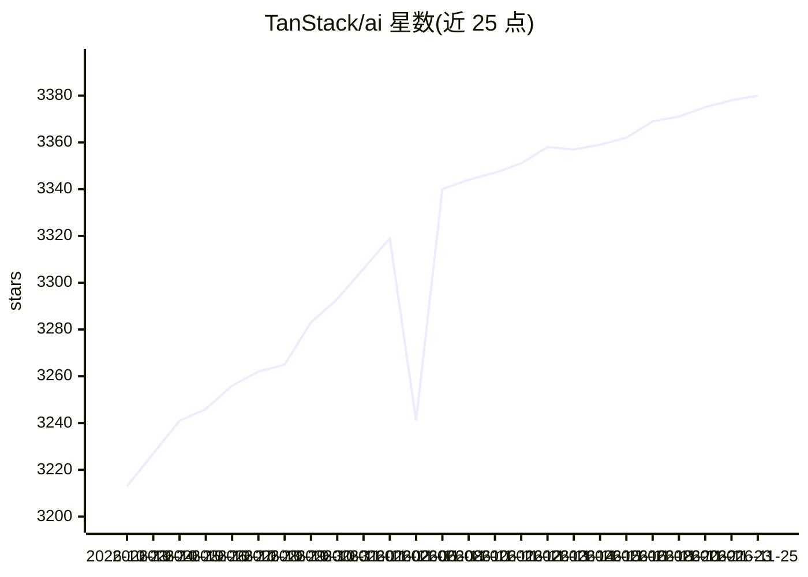

# TanStack/ai

⭐ 3,380 · TypeScript · MIT · 推送 2026-11-24 · [GitHub](https://github.com/TanStack/ai) · [官网](https://tanstack.com/ai/latest) · 组织维护

**面向 TypeScript 开发者的多提供商流式 AI 应用 SDK**

TanStack AI 是一个类型安全、provider 无关的 TypeScript SDK，用于构建流式聊天、工具调用 agent、结构化输出、实时语音、媒体生成与多模态应用。架构由可组合活动与 provider 适配器组成，可只用聊天或按需引入图像、音频、视频、语音、转录、Code Mode、devtools 与框架绑定；官方适配器覆盖 OpenRouter、OpenAI、Anthropic、Gemini、Vertex、Ollama、xAI、Groq 等，框架包提供 React/Solid/Vue/Svelte/Preact 的 hooks 与 headless UI。通过 pnpm/npm 安装核心包与所需适配器包，文档在线提供。

## 筛选速览

| 维度 | 判定 | 备注 |
|---|---|---|
| AI 角色 | `ai-ecosystem` | LLM/agent 周边工具 |
| 许可风险 | `permissive` | MIT |
| 部署形态 | `library` | 以包/库形式分发 |
| 模型依赖 | local-ok | 支持本地模型 |
| 硬件要求 | — | 无带数字的原话,不猜 |
| 安装摩擦 | `low` | 无编译、无系统依赖或容器化 |
| 成熟度 | — | 结构信号不足 |

## 能力要点

- 类型安全工具定义：一处声明 toolDefinition()，服务端/客户端共享输入输出类型
- 官方 provider 适配器表覆盖 OpenRouter/OpenAI/Anthropic/Gemini/Vertex/Ollama/xAI/Groq 等 16 个包
- 适配器按活动 tree-shakeable，支持运行时切换 provider
- React/Solid/Vue/Svelte/Preact hooks 与 headless 聊天/实时/生成客户端

## 适用场景

- 在 React/Vue/Svelte 应用里加流式聊天与工具调用
- 用一个 OpenRouter API key 接入 300+ 模型并按请求追踪成本
- 本地用 Ollama 模型开发聊天应用
- 构建带 OpenTelemetry 追踪与 devtools 的可观测 AI 应用

## 场景标签

`Agent 框架` · 领域:Agent 开发

## 证据(README 行号)

> L37: Type-safe, provider-agnostic TypeScript SDK for building streaming chat,
> L41: TanStack AI is built from composable activities and provider adapters. Use one
> L186: |Package|Use it for|

## 星数曲线

2026-10-23 3,213 → 2026-11-25 3,380（+167）

---
*卡片 v1 · prompt 1.4 · 生成 2026-11-24 · 置信度 high · 依据 README sha `db6588664fe1` · [字段定义](../../DATASET.md)*
