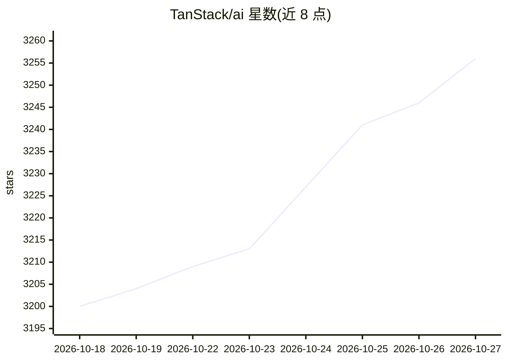

# TanStack/ai

⭐ 3,256 · TypeScript · MIT · 推送 2026-10-26 · [GitHub](https://github.com/TanStack/ai) · [官网](https://tanstack.com/ai/latest) · 组织维护

**TypeScript AI SDK：类型安全、多提供商地构建流式聊天/Agent/多模态应用**

TanStack 出品的 TypeScript AI SDK，由可组合的活动（activity）与提供商适配器构成：支持流式聊天、类型安全工具调用、结构化输出（Zod/ArkType/Valibot）、图像/音频/视频/语音/转录生成、实时语音聊天，以及让 LLM 在隔离沙箱中编写并执行 TypeScript 的 Code Mode。官方适配器覆盖 OpenAI、Anthropic、Gemini、Vertex、OpenRouter（300+ 模型）、Ollama 本地模型、Grok、Groq、ElevenLabs、fal.ai、Cloudflare 等十余家；并提供 React/Solid/Vue/Svelte/Preact 框架包与 headless 客户端，适配器按活动可 tree-shake。面向在应用中接入模型能力的 Web/全栈开发者。

## 筛选速览

| 维度 | 判定 | 备注 |
|---|---|---|
| AI 角色 | `ai-ecosystem` | LLM/agent 周边工具 |
| 许可风险 | `permissive` | MIT |
| 部署形态 | `library` | 以包/库形式分发 |
| 模型依赖 | local-ok | 支持本地模型 |
| 硬件要求 | — | 无带数字的原话,不猜 |
| 安装摩擦 | `low` | 无编译、无系统依赖或容器化 |
| 成熟度 | — | 结构信号不足 |

## 能力要点

- 十余个官方提供商适配器，含 Ollama 本地模型与 OpenRouter 多模型通道
- 类型安全工具定义与结构化输出（Zod/ArkType/Valibot/JSON Schema）
- Code Mode：LLM 在隔离沙箱中编写执行 TypeScript 以编排工具
- React/Solid/Vue/Svelte/Preact 框架绑定与 headless 客户端

## 适用场景

- 在 React/Vue 等前端框架中构建流式聊天界面
- 编写跨服务端/客户端共享的类型安全工具调用
- 通过统一接口在多个模型提供商之间切换或接入本地 Ollama
- 构建实时语音、多模态生成类应用

## 场景标签

`多模态` `Agent 框架` · 领域:Agent 开发

## 证据(README 行号)

> L37: Type-safe, provider-agnostic TypeScript SDK for building streaming chat,
> L41: TanStack AI is built from composable activities and provider adapters. Use one
> L186: |Package|Use it for|

## 星数曲线

2026-10-18 3,200 → 2026-10-27 3,256（+56）

---
*卡片 v1 · prompt 1.4 · 生成 2026-10-20 · 置信度 high · 依据 README sha `f32b44b960e2` · [字段定义](../../DATASET.md)*
