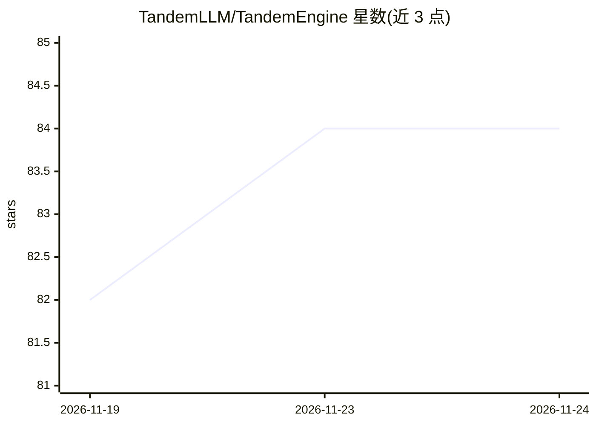

# TandemLLM/TandemEngine

⭐ 84 · Python · AGPL-3.0 · 推送 2026-11-23 · [GitHub](https://github.com/TandemLLM/TandemEngine) · [官网](https://tandemengine.0xbakeer.com) · 个人维护

**在 NVIDIA DGX Spark 上本地运行大模型的推理引擎**

TandemEngine 是面向单台 NVIDIA DGX Spark 的推理引擎，以 OpenAI 兼容 API 对外提供补全接口。核心机制为投机解码：小起草模型猜测后续 token，大模型一次验证全部猜测，错误处由大模型回填自身 token；配合 NVFP4 与六档 EXL3 量化权重提供多种 profile。通过 use-profile.sh 脚本下载并校验 sha256 后在 8000 端口启动服务。README 同时含 TandemApp 应用层（chat/模型管理），其 chat 模式标注为 beta 且未纳入测速。

## 筛选速览

| 维度 | 判定 | 备注 |
|---|---|---|
| AI 角色 | `ai-ecosystem` | LLM/agent 周边工具 |
| 许可风险 | `dual` | AGPL-3.0 |
| 部署形态 | `library` | 以包/库形式分发 |
| 模型依赖 | — | README 未给出锁定关系 |
| 硬件要求 | — | 无带数字的原话,不猜 |
| 安装摩擦 | `medium` | 含编译或系统依赖之一 |
| 成熟度 | — | 结构信号不足 |

## 能力要点

- OpenAI 兼容 API（/v1/completions）的本地推理服务
- 投机解码：小起草器猜 token、大模型一次批量验证
- NVFP4 与 EXL3（2.0–6.0 比特）多档量化 profile，含 KL/top-1 与 BF16 对照表
- use-profile.sh 一键下载权重并校验 hub sha256

## 适用场景

- 在 DGX Spark 上自托管大模型推理服务
- 以 OpenAI 兼容接口接入本地模型
- 按显存与速度需求选择不同量化档位运行模型

## 场景标签

`推理引擎` `模型量化` · 领域:训练与推理

## 证据(README 行号)

> L22: TandemEngine is TandemLLM's inference engine for one NVIDIA DGX Spark; the app (chat, models, fleet) is TandemApp. 
> L28: TandemLLM is a working name, and it says how the engine works. Small drafters guess the next tokens, and the big mo

## 星数曲线

2026-11-19 82 → 2026-11-24 84（+2）

---
*卡片 v1 · prompt 1.4 · 生成 2026-11-19 · 置信度 mid · 依据 README sha `7a93204d3750` · [字段定义](../../DATASET.md)*
