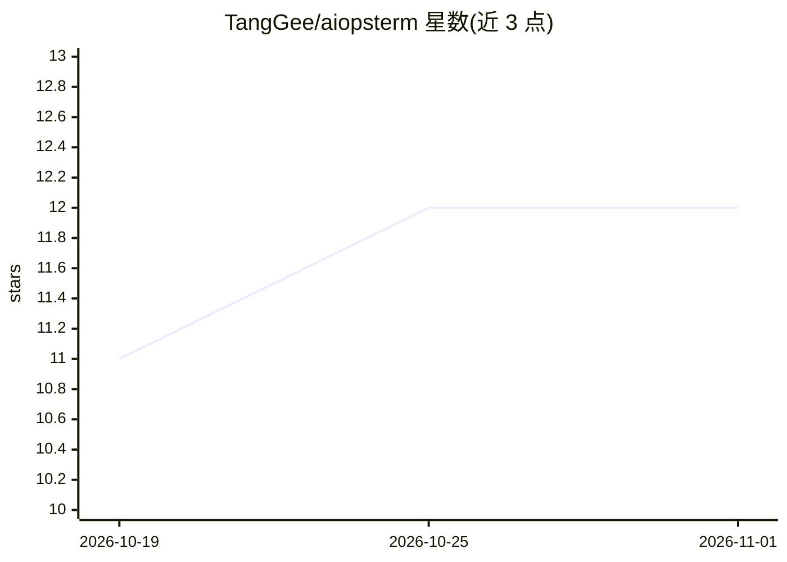

# TangGee/aiopsterm

⭐ 12 · TypeScript · Apache-2.0 · 推送 2026-10-27 · [GitHub](https://github.com/TangGee/aiopsterm) · [官网](https://aiopsterm.com) · 组织维护 · 中文 README

**面向人和 AI 的运维终端：终端/SSH/数据库/K8s 一体化桌面工作区**

基于 Electron 的桌面运维终端，把多标签分屏终端、SSH 与 JumpServer 堡垒机资产同步、文件 SFTP、Kubernetes 资源管理与 kubectl 终端、多类型数据库 SQL 控制台收进同一工作区。AI 部分：内嵌 Codex CLI 主机 Agent 经绑定终端执行命令，集中管理 Codex、Claude Code、Kimi Code 等外部 AI 编程会话，MCP 双向集成，DB AI 提供自然语言转 SQL 与诊断。安装包全平台签名发布，macOS 经 Apple 公证，遥测可关闭。

## 筛选速览

| 维度 | 判定 | 备注 |
|---|---|---|
| AI 角色 | `ai-enhanced` | 去掉 AI 部分产品仍成立 |
| 许可风险 | `permissive` | Apache-2.0 |
| 部署形态 | `None` |  |
| 模型依赖 | — | README 未给出锁定关系 |
| 硬件要求 | — | 无带数字的原话,不猜 |
| 安装摩擦 | `low` | 无编译、无系统依赖或容器化 |
| 成熟度 | — | 结构信号不足 |

## 能力要点

- 集中接入 Codex、Claude Code、Kimi Code 等外部 AI 编程会话并可审查 transcript
- MCP 双向集成：接入第三方 Server，同时导出 SSH/AI 会话/数据库只读能力
- SSH 与 JumpServer 堡垒机资产同步，远程主机无需安装 Agent
- DB AI 支持自然语言转 SQL、解释与诊断（MySQL/PostgreSQL/Oracle 等）

## 适用场景

- 在一个桌面工作区里同时管理本地与远程终端、数据库和 Kubernetes
- 统一管理多个外部 AI 编程会话并审查其文件变更
- 通过 MCP 把主机 SSH 和数据库能力提供给外部 Agent

## 场景标签

`数据分析` · 领域:效率与自动化

## 证据(README 行号)

> L5: **为人和 AI 打造的运维终端**：把终端、SSH 与堡垒机、主机 Agent、AI 会话、文件、资产、MCP、数据库 AI 和 Kubernetes 收进同一个桌面工作区。
> L19: - **多标签终端工作区** — 本地与远程终端共享标签、左右/上下分屏、拖拽合并、搜索与多终端广播，内置 `aio`、`aiossh` 等控制命令。
> L22: - **AI 会话管理** — 集中接入 Codex、Claude Code、OpenCode、Kimi Code 等外部 AI 编程会话，实时状态与桌面通知，可查看、搜索并修订完整 transcript，审查项目文件变更。

## 星数曲线

2026-10-19 11 → 2026-11-01 12（+1）

---
*卡片 v1 · prompt 1.4 · 生成 2026-11-01 · 置信度 high · 依据 README sha `2ba4432041b8` · [字段定义](../../DATASET.md)*
