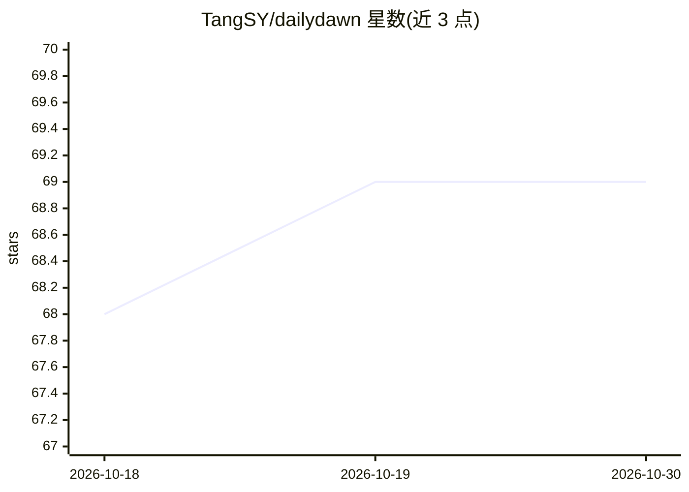

# TangSY/dailydawn

⭐ 69 · Python · 推送 2026-10-29 · [GitHub](https://github.com/TangSY/dailydawn) · [官网](https://dailydawn.dev) · 个人维护 · 中文 README

**面向独立开发者的 AI 生成中英双语趋势日报**

由 GitHub Actions 每天 UTC 00:00 调度的自动化日报系统：从 Hacker News、GitHub Trending、Product Hunt、Reddit、HuggingFace、V2EX、Google Trends 七个信号源抓取 150+ 条信号，跨源去重后按 5 个维度（机会/选型/竞争情报/需求雷达/趋势）各派一个 agent 深挖，主笔合成约 5000 中文字/5500 英文词的双语日报。每天约 18 次 LLM 调用，走任意 OpenAI 兼容网关。约 1500 行 Python，零数据库；Web 订阅分发层在另一私有仓库。

## 筛选速览

| 维度 | 判定 | 备注 |
|---|---|---|
| AI 角色 | `ai-native` | 本体是模型或模型工具 |
| 许可风险 | `none` | — |
| 部署形态 | `library` | 以包/库形式分发 |
| 模型依赖 | — | README 未给出锁定关系 |
| 硬件要求 | — | 无带数字的原话,不猜 |
| 安装摩擦 | `low` | 无编译、无系统依赖或容器化 |
| 成熟度 | — | 结构信号不足 |

## 能力要点

- 7 个信号源自动抓取 150+ 条信号并跨源去重
- 5 个维度各由一个 agent 深挖后主笔合成双语日报
- 每日 20 个基于当日信号动态生成的深度小节
- 任一数据源失败自动跳过，不阻塞流水线

## 适用场景

- 独立开发者每天了解值得做与要避开的方向
- 跟踪 GitHub/HN/Product Hunt 等渠道的开发者生态动态
- 以中英双语邮件订阅或 RSS 获取每日 AI 趋势摘要

## 场景标签

`AI 写作` `多智能体` `网页抓取` · 领域:Agent 开发

## 证据(README 行号)

> L28: DailyDawn 替你把这件事干完：每天 UTC 00:00 自动从 7 个信号源抓 150+ 条原始信号，跨源去重后分进 5 个维度（**发现机会 / 技术选型 / 竞争情报 / 需求雷达 / 趋势判断**），每个维度派一个 
> L79: 每天约 18 次 LLM 调用，走任意 OpenAI 兼容网关（DeepSeek / OpenAI / Doubao 等都行）。

## 星数曲线

2026-10-18 68 → 2026-10-30 69（+1）

---
*卡片 v1 · prompt 1.4 · 生成 2026-10-24 · 置信度 high · 依据 README sha `ebc638a2dbf4` · [字段定义](../../DATASET.md)*
