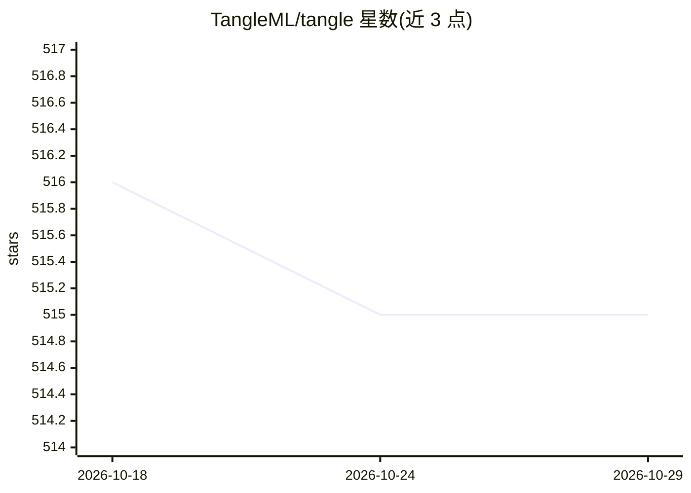

# TangleML/tangle

⭐ 515 · Python · Apache-2.0 · 推送 2026-10-27 · [GitHub](https://github.com/TangleML/tangle) · [官网](https://tangleml.com/) · 个人维护

**可视化构建与运行 ML 流水线的 Web 应用，免配开发环境**

Tangle 是一个流水线编排 Web 应用：用户在浏览器中拖拽组件、连线配置，提交执行有始有终的批处理工作流（如 XGBoost 训练）。组件为容器化命令行程序，可用任意语言编写，兼容 Google Cloud Vertex AI Pipelines 与 Kubeflow Pipelines 的 ComponentSpec 格式。支持执行缓存复用、运行克隆与严格版本化保证可复现。可在本地通过 Docker/Podman 启动器运行，或经 HuggingFace Job launcher 在 HuggingFace Spaces 上使用（运行需 HF Pro 订阅）；本地安装依赖 Docker 与 uv，后端由 API Server 与 Orchestrator 组成，支持 SQLite/MySQL。

## 筛选速览

| 维度 | 判定 | 备注 |
|---|---|---|
| AI 角色 | `ai-ecosystem` | LLM/agent 周边工具 |
| 许可风险 | `permissive` | Apache-2.0 |
| 部署形态 | `None` |  |
| 模型依赖 | — | README 未给出锁定关系 |
| 硬件要求 | — | 无带数字的原话,不猜 |
| 安装摩擦 | `low` | 无编译、无系统依赖或容器化 |
| 成熟度 | — | 结构信号不足 |

## 能力要点

- 可视化拖拽构建流水线，本地或云端一键提交执行
- 组件为容器化命令行程序，兼容 Vertex AI / Kubeflow Pipelines 格式
- 执行结果缓存复用与严格组件版本化，运行可克隆重跑
- 支持本地 Docker、本地 Kubernetes、GKE 三种 Launcher

## 适用场景

- 不搭开发环境，在浏览器里搭建并运行 ML 训练/数据处理流水线
- 把容器化的批处理任务编排为可复现、可缓存复用的流水线
- 团队在 HuggingFace Space 上部署共享的多用户流水线环境

## 场景标签

`工作流自动化` `MLOps` · 领域:效率与自动化

## 证据(README 行号)

> L3: The Tangle system helps users create and run ML experiments and production pipelines.
> L124: A **pipeline system** like Tangle orchestrates containerized command-line programs.
> L119:  * Compatible with Google Cloud Vertex AI Pipelines and Kubeflow Pipelines

## 星数曲线

2026-10-18 516 → 2026-10-29 515（-1）

---
*卡片 v1 · prompt 1.4 · 生成 2026-10-21 · 置信度 high · 依据 README sha `e4d82a84b2d9` · [字段定义](../../DATASET.md)*
