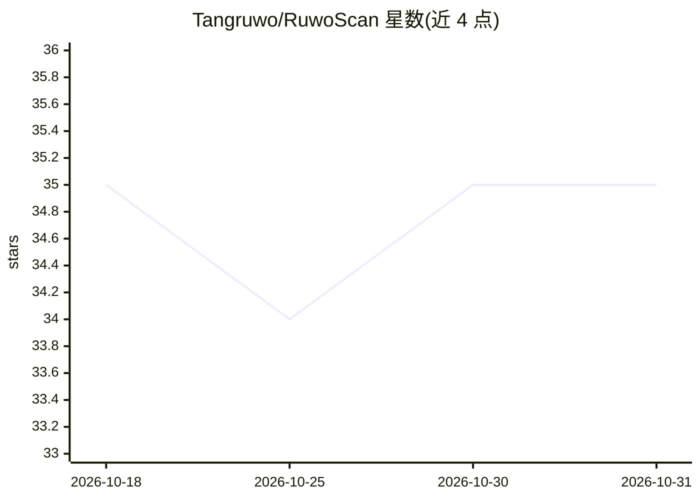

# Tangruwo/RuwoScan

⭐ 35 · Python · MIT · 推送 2026-09-18 · [GitHub](https://github.com/Tangruwo/RuwoScan) · 个人维护 · 中文 README

**多智能体自动化 AI 漏洞扫描工具：自然语言驱动完整渗透测试**

基于 Agentic 框架的自动化漏洞扫描工具，用自然语言下达指令后由多个智能体角色（指挥官、侦察兵、攻击者、报告员）协同完成探测、渗透测试、漏洞验证与 Markdown 报告生成。AI 自主决定攻击目标、方式与推进时机，可调用文件操作、HTTP 请求、目录扫描及运行 Python 程序等工具。通过 OpenAI 兼容 API 接入大模型，提供终端与 Web 可视化两种界面，克隆仓库并 pip 安装依赖即可使用。

## 筛选速览

| 维度 | 判定 | 备注 |
|---|---|---|
| AI 角色 | `ai-native` | 本体是模型或模型工具 |
| 许可风险 | `permissive` | MIT |
| 部署形态 | `library` | 以包/库形式分发 |
| 模型依赖 | — | README 未给出锁定关系 |
| 硬件要求 | — | 无带数字的原话,不猜 |
| 安装摩擦 | `low` | 无编译、无系统依赖或容器化 |
| 成熟度 | — | 结构信号不足 |

## 能力要点

- 多智能体协同：指挥官/侦察兵/攻击者/报告员四角色分工
- AI 自主决策攻击目标、方式与阶段推进
- 完整工具链：文件操作、HTTP 请求、目录扫描、自主运行 Python
- 自动生成含漏洞类型、位置、修复建议的结构化报告

## 适用场景

- 用自然语言指令对目标网站做黑盒渗透测试
- 自动化漏洞扫描并产出可交付的 Markdown 报告
- 通过 Web 界面透明地查看与验证渗透过程

## 场景标签

`多智能体` `网络安全` · 领域:Agent 开发

## 证据(README 行号)

> L17: 基于Agentic 框架的自动化AI漏洞扫描工具
> L20: 核心理念：让 AI ***主导渗透测试***，而不是***辅助扫描***
> L29: - **多智能体协同** 指挥官(拟定方向) 侦察兵(信息收集) 攻击者(漏洞测试,验证) 报告员(生成报告)

## 星数曲线

2026-10-18 35 → 2026-10-31 35（+0）

---
*卡片 v1 · prompt 1.4 · 生成 2026-10-25 · 置信度 mid · 依据 README sha `43a590dc09fb` · [字段定义](../../DATASET.md)*
