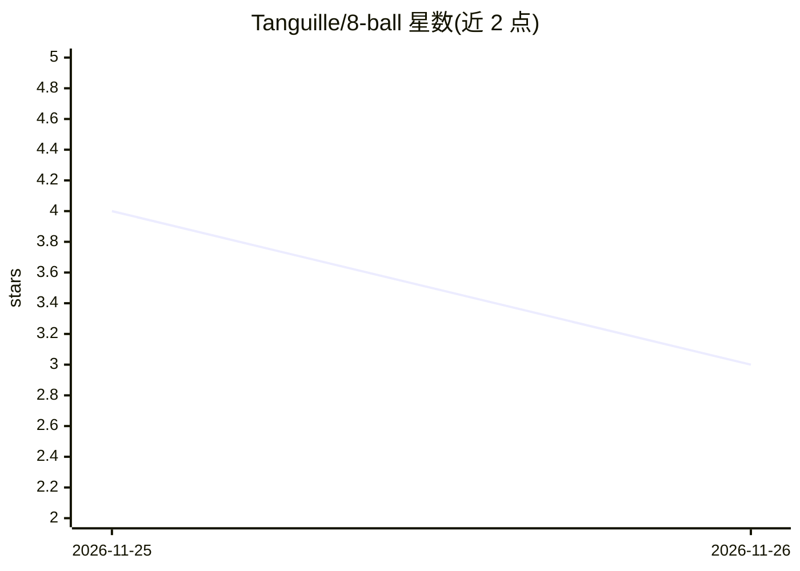

# Tanguille/8-ball

⭐ 3 · Rust · MIT · 推送 2026-11-25 · [GitHub](https://github.com/Tanguille/8-ball) · 个人维护

**给 AI agent 提供类型化决策判定的 Rust 决策模型工具**

8-ball 是用 Rust 编写的决策模型工具，通过小模型为 AI agent 提供 yes/no（noul）、choice、score 三类判定，用于筛选值得读取/处理的内容，返回 `unsure` 时由 agent 自行处理。判定结果存入 SQLite 复用，支持通过已知答案进行校准学习。接入方式包括 MCP、HTTP API 与 CLI，MCP 客户端覆盖 Claude Code、Codex、Cursor、qwen-code、OpenCode。首次运行下载约 4.5 GB 开发模型，支持 GPU 与 CPU（EIGHTBALL_DEV_NGL=0），提供容器镜像与 Helm chart。README 声明处于早期开发，接口与数据格式可能变更。

## 筛选速览

| 维度 | 判定 | 备注 |
|---|---|---|
| AI 角色 | `ai-ecosystem` | LLM/agent 周边工具 |
| 许可风险 | `permissive` | MIT |
| 部署形态 | `library` | 以包/库形式分发 |
| 模型依赖 | — | README 未给出锁定关系 |
| 硬件要求 | — | 无带数字的原话,不猜 |
| 安装摩擦 | `low` | 无编译、无系统依赖或容器化 |
| 成熟度 | `idea` | |

## 能力要点

- 通过 MCP、REST API 与 CLI 提供类型化的 yes/no、choice、score 判定
- 判定结果保存于 SQLite，并支持用已知答案校准学习
- CPU 与 GPU 均可运行，缓存答案响应在 10 ms 以内
- 提供容器镜像与 Helm chart 用于服务器/Kubernetes 部署

## 适用场景

- 让 agent 先判定哪些链接值得完整阅读，节省 token
- 对告警消息按保存的问题（spec）做分诊过滤
- 在脚本中用 yes 判定的退出码触发后续动作
- 对工单文本做团队路由分类

## 场景标签

`模型评测` · 领域:评测与运维

## 证据(README 行号)

> L6: 8-ball uses a small model to help AI agents decide what is worth reading or acting on. If 8-ball returns `unsure`, t
> L83: |HTTP and MCP API|Routes, authentication, MCP tools|
> L86: |MCP clients|Claude Code, Codex, Cursor, qwen-code, OpenCode|

## 星数曲线

2026-11-25 4 → 2026-11-26 3（-1）

---
*卡片 v1 · prompt 1.4 · 生成 2026-11-24 · 置信度 high · 依据 README sha `62161bc83bbb` · [字段定义](../../DATASET.md)*
