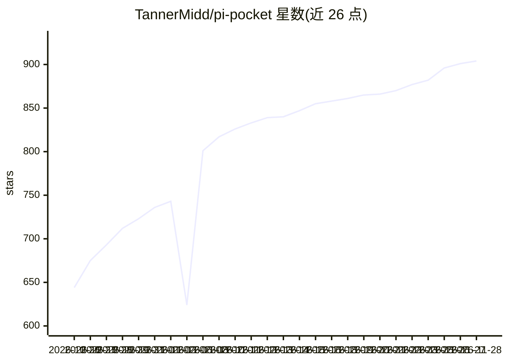

# TannerMidd/pi-pocket

⭐ 904 · TypeScript · MIT · 推送 2026-11-27 · [GitHub](https://github.com/TannerMidd/pi-pocket) · [官网](https://tannermidd.github.io/pi-pocket/) · 个人维护

**让开发者在手机上接入并协作管理本机 Pi 编码 agent 的自托管应用**

基于 Pi Durable 构建的移动优先多人 Web 应用，将运行在用户本机与项目中的 Pi 编码 agent 会话延伸到手机等多设备：跨设备查看 diff、审批推送、以 PiP 方式跟进多个会话、邀请队友观看或介入同一会话。支持通过 Discord/Slack/Telegram/Matrix 中继对话、子代理编排与会话链接、服务器重启后恢复运行、Chromium 内浏览器测试与会话 fork 到 git worktree。安装需 Node.js 22.19+，提供 Windows/macOS 安装包、npm 全局安装、Docker/Podman/Termux/Nix/systemd 等途径；内置浏览器依赖宿主机 Chromium 系浏览器。

## 筛选速览

| 维度 | 判定 | 备注 |
|---|---|---|
| AI 角色 | `ai-ecosystem` | LLM/agent 周边工具 |
| 许可风险 | `permissive` | MIT |
| 部署形态 | `desktop` | 安装包/桌面程序 |
| 模型依赖 | — | README 未给出锁定关系 |
| 硬件要求 | — | 无带数字的原话,不猜 |
| 安装摩擦 | `low` | 无编译、无系统依赖或容器化 |
| 成熟度 | — | 结构信号不足 |

## 能力要点

- 跨设备访问本机 Pi 会话：手机查看 diff、审批、多会话 PiP 跟进
- Relay 将 Discord/Slack/Telegram/Matrix 对话接入 Pi 会话，从本机发起连接无需公网服务器
- Pi Durable 持久化：服务器重启后恢复运行，可定时检查或跟踪 pull request 状态
- 多人协作：邀请队友观看或引导会话，支持侧聊与队列跟进

## 适用场景

- 在电脑上启动编码会话后，用手机查看 diff 并审批推送
- 通过聊天软件在 Discord/Slack 中向 Pi 询问构建失败原因
- 给子代理分配独立任务并让链接会话回报结果
- 邀请队友远程观看或介入同一编码会话

## 场景标签

`编码 Agent` · 领域:编码与开发

## 证据(README 行号)

> L3: **Your Pi coding agent, in your pocket.**
> L5: Start a coding session on your computer, check its diff on your phone, and invite a teammate to the same conversatio
> L17: - **Relay.** Connect a Discord, Slack, Telegram, or Matrix conversation to a Pi session. Ask Pi about a failing bui
> L34: Or try `npx pi-pocket`. Choose how your devices should connect, then open the launcher’s sign-in link or scan its Q

## 星数曲线

2026-10-26 644 → 2026-11-28 904（+260）

---
*卡片 v1 · prompt 1.4 · 生成 2026-11-25 · 置信度 high · 依据 README sha `baca7186374f` · [字段定义](../../DATASET.md)*
