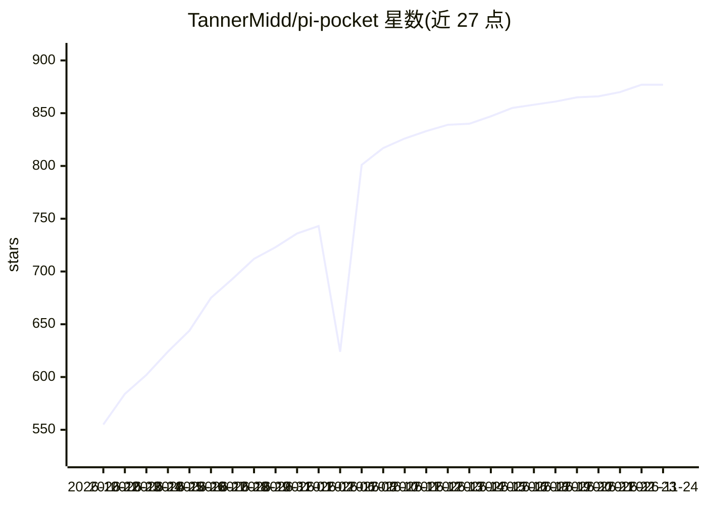

# TannerMidd/pi-pocket

⭐ 877 · TypeScript · MIT · 推送 2026-11-22 · [GitHub](https://github.com/TannerMidd/pi-pocket) · [官网](https://tannermidd.github.io/pi-pocket/) · 个人维护

**自托管的移动优先 Web 应用：在手机上运行与管理 Pi 编码代理会话**

基于 Pi Durable 构建的 Web 应用，为 Pi 编码代理提供持久化与多用户会话界面：每次模型调用、工具调用和子代理动作即时落盘，服务器重启后任务继续；支持多人共享会话（在线状态、Pi 不可见的侧聊、邀请与角色）、推送通知、语音输入、PiP 会话跟随助手、内置浏览器与扩展机制。通过 npm、Windows/macOS 安装包、Docker、Nix 或 Android Termux 运行，支持 local/lan/cloudflare/tailscale 等远程访问模式与 Unix socket 反向代理部署。README 警告：可操控会话者能以本机用户身份执行命令。

## 筛选速览

| 维度 | 判定 | 备注 |
|---|---|---|
| AI 角色 | `ai-ecosystem` | LLM/agent 周边工具 |
| 许可风险 | `permissive` | MIT |
| 部署形态 | `desktop` | 安装包/桌面程序 |
| 模型依赖 | — | README 未给出锁定关系 |
| 硬件要求 | — | 无带数字的原话,不猜 |
| 安装摩擦 | `low` | 无编译、无系统依赖或容器化 |
| 成熟度 | — | 结构信号不足 |

## 能力要点

- 会话数据即时持久化，服务器重启后任务继续运行
- 多人共享会话：在线状态、侧聊、邀请与角色控制
- 移动端适配：推送通知、语音输入、主屏幕 PWA
- 提供内置浏览器、PiP 会话跟随助手与运行中扩展热加载

## 适用场景

- 在手机上随时查看并操控自己的 Pi 编码代理会话
- 与队友共享实时代理会话并由人工审批 git push 等操作
- 自托管部署，通过 Cloudflare/Tailscale 隧道远程访问代理

## 场景标签

`编码 Agent` · 领域:编码与开发

## 证据(README 行号)

> L3: **Your Pi coding agent, in your pocket.**
> L5: A durable, multiplayer, mobile-first web app for Pi agents, built on Pi Durable.
> L18: - **Durable.** Every model call, tool call, and subagent is stored as it happens. Restart the server mid-run, and t

## 星数曲线

2026-10-22 555 → 2026-11-24 877（+322）

---
*卡片 v1 · prompt 1.4 · 生成 2026-11-24 · 置信度 high · 依据 README sha `7053c868250c` · [字段定义](../../DATASET.md)*
