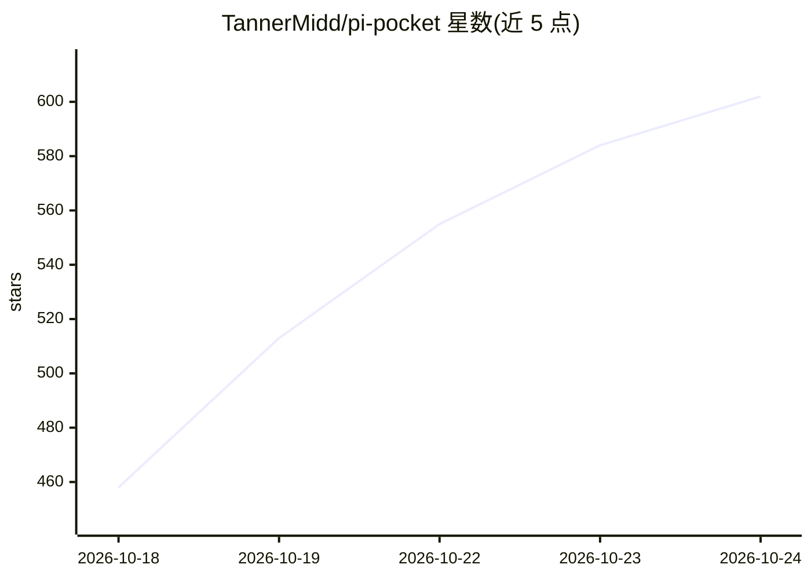

# TannerMidd/pi-pocket

⭐ 624 · TypeScript · MIT · 推送 2026-10-24 · [GitHub](https://github.com/TannerMidd/pi-pocket) · [官网](https://tannermidd.github.io/pi-pocket/) · 个人维护

**自托管的 Pi 编程 agent 移动优先 Web 客户端**

基于 Pi Durable 构建的 Web 应用，用于在自己的机器或 Android（Termux）手机上运行 Pi 编程 agent，无需云端 VM。特性包括：持久化存储每次模型/工具调用使重启后可续跑、多人共享实时会话（在场、提及、置顶、轮流）、会话分叉、计划模式审批、GitHub 仓库监控与 webhook、内置 Chromium 浏览器、扩展系统与危险命令审批（Lancet Guard，默认关闭）。模型接入复用 Pi 自身的运行时与登录，按会话选择模型。提供 Cloudflare/Tailscale 远程访问模式与 NixOS 模块。

## 筛选速览

| 维度 | 判定 | 备注 |
|---|---|---|
| AI 角色 | `ai-ecosystem` | LLM/agent 周边工具 |
| 许可风险 | `permissive` | MIT |
| 部署形态 | `library` | 以包/库形式分发 |
| 模型依赖 | — | README 未给出锁定关系 |
| 硬件要求 | — | 无带数字的原话,不猜 |
| 安装摩擦 | `low` | 无编译、无系统依赖或容器化 |
| 成熟度 | — | 结构信号不足 |

## 能力要点

- 模型调用、工具调用与子 agent 实时持久化，服务器重启后任务继续
- 多人共享实时会话：在场、旁路聊天、提及、置顶、轮流操作
- 复用 Pi 的模型运行时与登录，任意提供商任意模型，按会话选择
- 可运行于 Android（Termux），提供 PWA 主屏应用与推送通知

## 适用场景

- 在手机上随时查看并操控本机运行的 Pi 编程 agent 会话
- 团队多人实时围观和接管同一 agent 会话并审批危险操作
- 让 agent 监控 GitHub 仓库 CI 失败并自动修复汇报
- 自托管、不经云端 VM 地远程访问编程 agent

## 场景标签

`编码 Agent` · 领域:编码与开发

## 证据(README 行号)

> L5: A durable, multiplayer, mobile-first web app for Pi agents, built on Pi Durable.
> L43: - **Any provider, any model.** Uses Pi's own model runtime and sign-ins, skills, and prompt templates, with the mod

## 星数曲线

2026-10-18 458 → 2026-10-24 602（+144）

---
*卡片 v1 · prompt 1.4 · 生成 2026-10-21 · 置信度 high · 依据 README sha `a67d38187231` · [字段定义](../../DATASET.md)*
