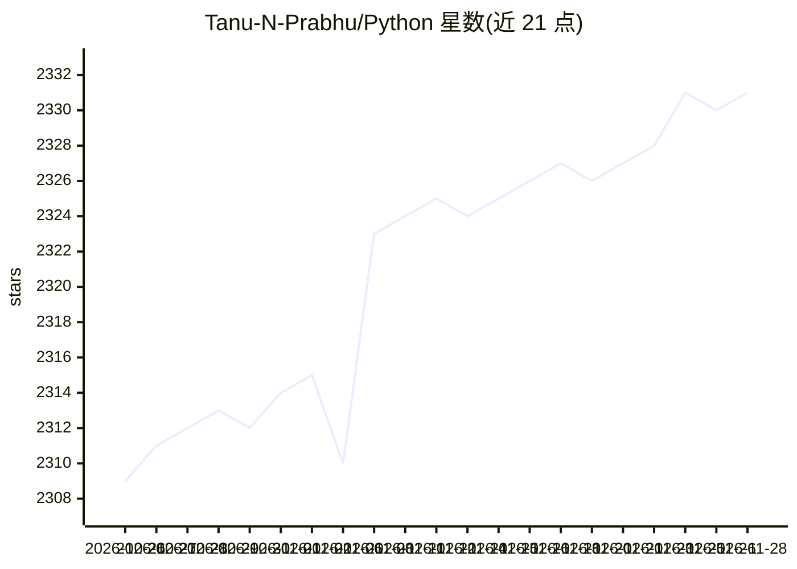

# Tanu-N-Prabhu/Python

⭐ 2,331 · Jupyter Notebook · 推送 2026-11-27 · [GitHub](https://github.com/Tanu-N-Prabhu/Python) · [官网](https://github.com/Tanu-N-Prabhu) · 个人维护

**从零学 Python、数据科学与机器学习的教程笔记本合集**

以 Jupyter Notebook 组织的学习资料库：Python 部分按章节覆盖基础语法、内置函数、NumPy/Pandas 等库、API 调用、设计原则、练习题、测验与面试题；机器学习部分涵盖回归、分类、聚类、神经网络、模型部署与多个端到端项目（房价预测、欺诈检测、MNIST 手写识别等）；数据科学部分包含数据探索、网页抓取与 EDA 问答。面向初学者到有经验的开发者，推荐配合 VS Code、Jupyter Notebook 或 Google Colab 使用。

## 筛选速览

| 维度 | 判定 | 备注 |
|---|---|---|
| AI 角色 | `ai-knowledge` | 知识聚合/清单类 |
| 许可风险 | `none` | — |
| 部署形态 | `None` |  |
| 模型依赖 | — | README 未给出锁定关系 |
| 硬件要求 | — | 无带数字的原话,不猜 |
| 安装摩擦 | `low` | 无编译、无系统依赖或容器化 |
| 成熟度 | — | 结构信号不足 |

## 能力要点

- 9 章 Python 教程：基础语法到设计原则与面试准备
- 机器学习路线图与 10 余个端到端实战项目
- 数据科学分 6 级递进教程及 25 道数据分析问答
- 支持通过 Google Colab 云端运行笔记本

## 适用场景

- 我想从零开始系统学习 Python 基础语法
- 我需要练习机器学习项目来准备面试或求职
- 我想在浏览器里用 Colab 直接运行教程笔记本

## 场景标签

`教程课程` · 领域:学习与行业

## 证据(README 行号)

> L3:  The Best Place to Learn Python, Data Science and Machine Learning!
> L130: #### 4. Machine Learning Materials
> L162: * **Novices** - Explore the fundamentals of Python programming.

## 星数曲线

2026-10-26 2,309 → 2026-11-28 2,331（+22）

---
*卡片 v1 · prompt 1.4 · 生成 2026-11-28 · 置信度 high · 依据 README sha `e37e82804899` · [字段定义](../../DATASET.md)*
