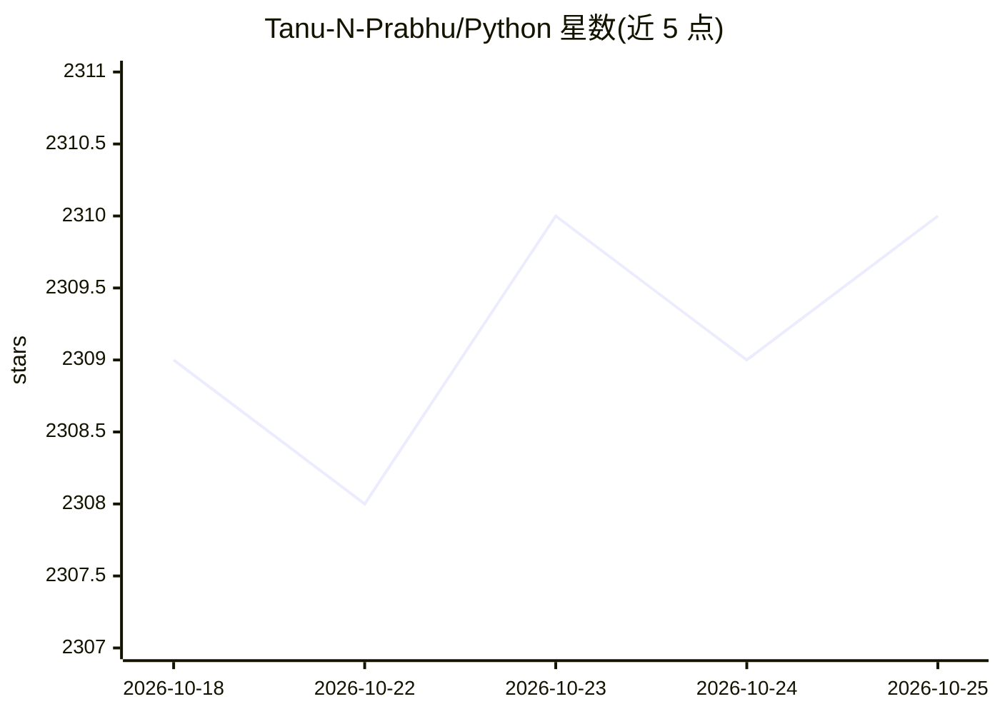

# Tanu-N-Prabhu/Python

⭐ 2,309 · Jupyter Notebook · 推送 2026-10-25 · [GitHub](https://github.com/Tanu-N-Prabhu/Python) · [官网](https://github.com/Tanu-N-Prabhu) · 个人维护

**从零学习 Python、数据科学与机器学习的教程仓库**

面向初学者到进阶开发者的 Python 编程与数据科学学习资源库：内容按章节组织，覆盖 Python 基础概念、内置函数、常用库（Numpy/Pandas）、API 使用、练习题、测验、面试题与设计原则；另含数据科学材料（数据探索、网页爬取、预处理）与机器学习路径（回归分类、聚类降维、深度学习、MLOps）及多个端到端项目（房价预测、情感分析、欺诈检测等）。以 Jupyter Notebook 与 Markdown 形式提供，推荐在本地或 Google Colab 中运行。

## 筛选速览

| 维度 | 判定 | 备注 |
|---|---|---|
| AI 角色 | `ai-knowledge` | 知识聚合/清单类 |
| 许可风险 | `none` | — |
| 部署形态 | `None` |  |
| 模型依赖 | — | README 未给出锁定关系 |
| 硬件要求 | — | 无带数字的原话,不猜 |
| 安装摩擦 | `low` | 无编译、无系统依赖或容器化 |
| 成熟度 | — | 结构信号不足 |

## 能力要点

- Python 基础到内置函数、库与 API 的分章节教程
- 机器学习路径覆盖回归、聚类、神经网络与 MLOps
- 含房价预测、信用卡欺诈检测等端到端实战项目
- 提供练习题、测验与面试准备材料

## 适用场景

- 从零开始系统学习 Python 编程
- 按路径学习数据科学与机器学习
- 准备 Python 或机器学习面试

## 场景标签

`教程课程` · 领域:学习与行业

## 证据(README 行号)

> L3:  The Best Place to Learn Python, Data Science and Machine Learning!
> L130: #### 4. Machine Learning Materials
> L138: #### 5. Data Science Materials
> L405: ## Machine Learning

## 星数曲线

2026-10-18 2,309 → 2026-10-25 2,310（+1）

---
*卡片 v1 · prompt 1.4 · 生成 2026-10-21 · 置信度 high · 依据 README sha `a3323c99e460` · [字段定义](../../DATASET.md)*
