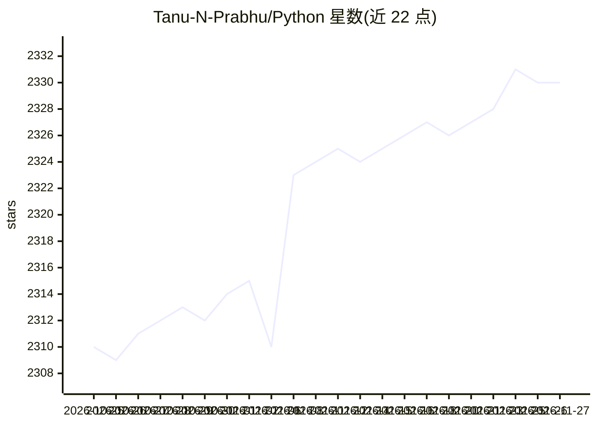

# Tanu-N-Prabhu/Python

⭐ 2,330 · Jupyter Notebook · 推送 2026-11-26 · [GitHub](https://github.com/Tanu-N-Prabhu/Python) · [官网](https://github.com/Tanu-N-Prabhu) · 个人维护

**面向 Python 初学者的编程、数据科学与机器学习教程集**

以 Jupyter Notebook 形式组织的教程仓库，内容分三大板块：Python 编码（基础语法、内置函数、NumPy/Pandas 等库、API 使用、练习与面试题）、数据科学（EDA、网络爬取、特征工程等分阶材料）、机器学习（回归分类、神经网络、MLOps 及房价预测、欺诈检测等端到端项目）。面向初学者、数据爱好者与开发者，推荐配合 VS Code、Jupyter Notebook 或 Google Colab 使用。

## 筛选速览

| 维度 | 判定 | 备注 |
|---|---|---|
| AI 角色 | `ai-knowledge` | 知识聚合/清单类 |
| 许可风险 | `none` | — |
| 部署形态 | `None` |  |
| 模型依赖 | — | README 未给出锁定关系 |
| 硬件要求 | — | 无带数字的原话,不猜 |
| 安装摩擦 | `low` | 无编译、无系统依赖或容器化 |
| 成熟度 | — | 结构信号不足 |

## 能力要点

- Python 基础到面试准备的章节化 Notebook 教程
- 机器学习部分含 10+ 端到端实战项目（如 MNIST 手写数字识别、情感分析）
- 数据科学材料按 Level 0-5 分级组织
- 支持通过 Gitpod 在线打开

## 适用场景

- 从零开始系统学习 Python 语法与常用库
- 准备 Python/机器学习面试题
- 按项目教程练习机器学习端到端流程

## 场景标签

`教程课程` · 领域:学习与行业

## 证据(README 行号)

> L45: #### 3. Python Materials
> L130: #### 4. Machine Learning Materials
> L138: #### 5. Data Science Materials

## 星数曲线

2026-10-25 2,310 → 2026-11-27 2,330（+20）

---
*卡片 v1 · prompt 1.4 · 生成 2026-11-27 · 置信度 high · 依据 README sha `3a6623ae3762` · [字段定义](../../DATASET.md)*
