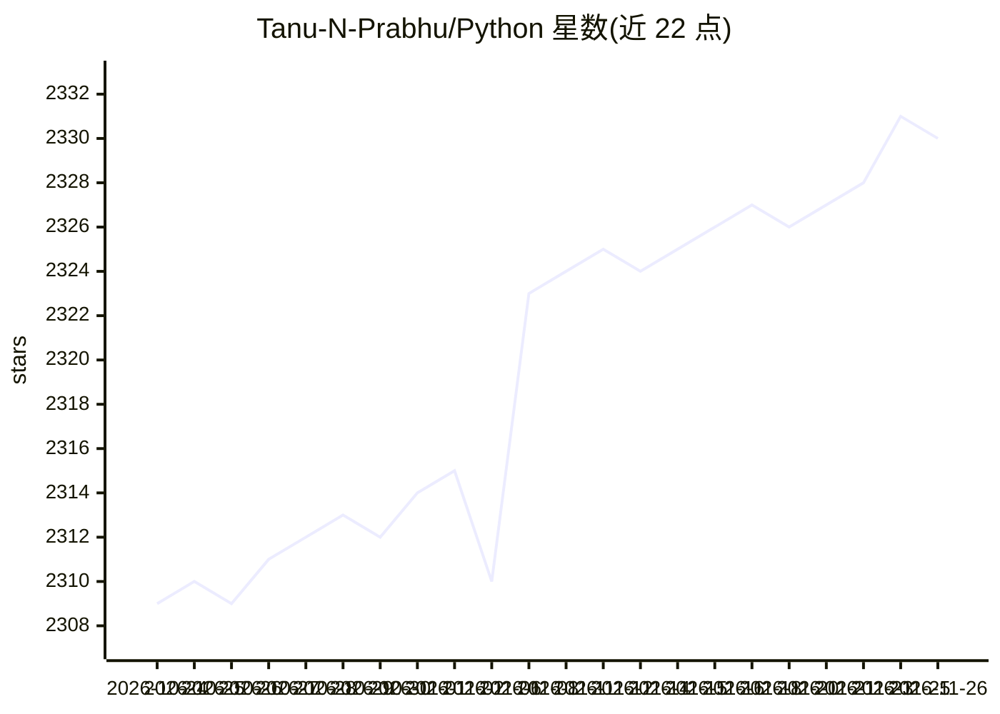

# Tanu-N-Prabhu/Python

⭐ 2,330 · Jupyter Notebook · 推送 2026-11-25 · [GitHub](https://github.com/Tanu-N-Prabhu/Python) · [官网](https://github.com/Tanu-N-Prabhu) · 个人维护

**为零基础学习者提供 Python、数据科学与机器学习教程合集**

以 Jupyter Notebook 为主的编程学习资源库，内容按章节组织：Python 基础语法、内置函数、NumPy/Pandas 等库、API 使用、练习题与面试准备；另设机器学习部分，覆盖回归、分类、聚类、神经网络及多个端到端项目（房价预测、欺诈检测、MNIST 手写数字识别等）。面向初学者、数据爱好者与有经验的开发者，内容配套 LinkedIn 发布的图文教程，支持通过 Gitpod 在线打开。

## 筛选速览

| 维度 | 判定 | 备注 |
|---|---|---|
| AI 角色 | `ai-knowledge` | 知识聚合/清单类 |
| 许可风险 | `none` | — |
| 部署形态 | `None` |  |
| 模型依赖 | — | README 未给出锁定关系 |
| 硬件要求 | — | 无带数字的原话,不猜 |
| 安装摩擦 | `low` | 无编译、无系统依赖或容器化 |
| 成熟度 | — | 结构信号不足 |

## 能力要点

- Python 基础到面试准备的分章节 Notebook 教程
- 机器学习材料覆盖回归/分类/聚类/神经网络/MLOps
- 10+ 个端到端 ML 项目（MNIST、欺诈检测、推荐系统等）
- 数据科学分 Level 0-5 组织，含 25 道数据分析问答

## 适用场景

- 从零开始学习 Python 基础语法与常用库
- 准备 Python/机器学习面试刷题
- 通过端到端项目练习 scikit-learn 建模流程

## 场景标签

`教程课程` · 领域:学习与行业

## 证据(README 行号)

> L3:  The Best Place to Learn Python, Data Science and Machine Learning!
> L130: #### 4. Machine Learning Materials
> L168: * **Python Proficiency** - Elevate your Python skills from beginner to advanced levels with my curated tutorials, 

## 星数曲线

2026-10-24 2,309 → 2026-11-26 2,330（+21）

---
*卡片 v1 · prompt 1.4 · 生成 2026-11-26 · 置信度 high · 依据 README sha `df0948557889` · [字段定义](../../DATASET.md)*
