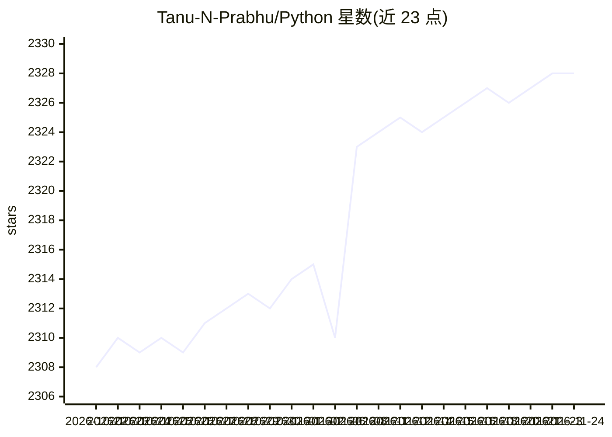

# Tanu-N-Prabhu/Python

⭐ 2,328 · Jupyter Notebook · 推送 2026-11-22 · [GitHub](https://github.com/Tanu-N-Prabhu/Python) · [官网](https://github.com/Tanu-N-Prabhu) · 个人维护

**Python/数据科学/机器学习入门教程笔记本合集**

以 Jupyter/Colab 笔记本为主的教程仓库，内容分三块：Python 编程（基础概念、内置函数、NumPy/Pandas 等库、API 使用、设计原则、练习与面试题）、数据科学（分 Level 0-5 的路径、数据抓取、EDA 与真实数据分析问答）、机器学习（数学基础、回归/分类、聚类、神经网络、部署与监控，以及房价预测、情感分析等端到端项目）。面向从零开始的初学者到进阶开发者，推荐配合 VS Code、Jupyter Notebook 与 Google Colab 使用，无独立安装包。

## 筛选速览

| 维度 | 判定 | 备注 |
|---|---|---|
| AI 角色 | `ai-knowledge` | 知识聚合/清单类 |
| 许可风险 | `none` | — |
| 部署形态 | `None` |  |
| 模型依赖 | — | README 未给出锁定关系 |
| 硬件要求 | — | 无带数字的原话,不猜 |
| 安装摩擦 | `low` | 无编译、无系统依赖或容器化 |
| 成熟度 | — | 结构信号不足 |

## 能力要点

- Python 从基础到设计原则与面试准备的分章节教程
- 机器学习路径覆盖回归、聚类、神经网络到部署与监控
- 包含约 10 个端到端 ML 项目（房价、欺诈检测、MNIST 等）
- 推荐 VS Code / Jupyter / Google Colab 作为学习工具

## 适用场景

- 从零开始系统学习 Python 编程基础
- 按分级路径入门数据科学与数据分析
- 通过端到端项目练习机器学习建模
- 准备 Python 与机器学习面试

## 场景标签

`教程课程` · 领域:学习与行业

## 证据(README 行号)

> L3:  The Best Place to Learn Python, Data Science and Machine Learning!
> L130: #### 4. Machine Learning Materials
> L207: #### This repository is divided into two parts such as Python Coding and Data Science for Beginners.

## 星数曲线

2026-10-22 2,308 → 2026-11-24 2,328（+20）

---
*卡片 v1 · prompt 1.4 · 生成 2026-11-23 · 置信度 high · 依据 README sha `592cbd7e453a` · [字段定义](../../DATASET.md)*
