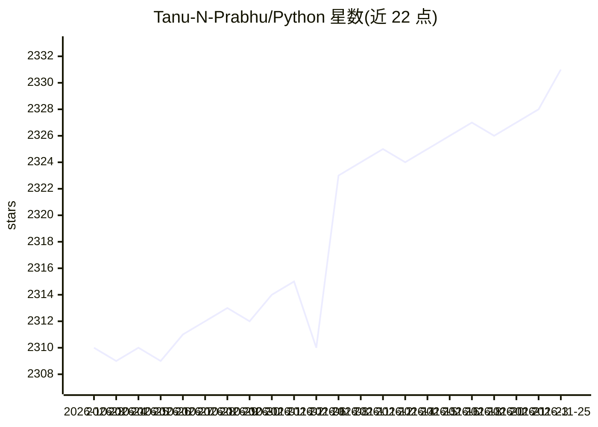

# Tanu-N-Prabhu/Python

⭐ 2,331 · Jupyter Notebook · 推送 2026-11-23 · [GitHub](https://github.com/Tanu-N-Prabhu/Python) · [官网](https://github.com/Tanu-N-Prabhu) · 个人维护

**Python 与机器学习零基础学习教程库（Jupyter/Colab 笔记本）**

以 Jupyter Notebook 和 Google Colab 笔记本组织的教学仓库，内容按 Python 编码与数据科学/机器学习两大部分编排：前者覆盖基础语法、内置函数、NumPy/Pandas 库、API 调用、设计原则、练习题与面试题；后者包含监督/无监督学习、神经网络、MLOps，以及房价预测、欺诈检测、情感分析等端到端项目。README 提供工具清单（Python、VS Code、Jupyter、Colab），内容面向初学者、数据爱好者与有经验开发者。

## 筛选速览

| 维度 | 判定 | 备注 |
|---|---|---|
| AI 角色 | `ai-knowledge` | 知识聚合/清单类 |
| 许可风险 | `none` | — |
| 部署形态 | `None` |  |
| 模型依赖 | — | README 未给出锁定关系 |
| 硬件要求 | — | 无带数字的原话,不猜 |
| 安装摩擦 | `low` | 无编译、无系统依赖或容器化 |
| 成熟度 | — | 结构信号不足 |

## 能力要点

- Python 语法、库、API、练习、面试准备九章教程
- 机器学习章节含回归、聚类、深度学习与 MLOps 内容
- 十余个端到端 ML 项目（MNIST、欺诈检测、推荐系统等）
- 支持通过 Gitpod 在云端打开

## 适用场景

- 从零开始学 Python 语法与常用库
- 按数据科学分级路径系统学习数据分析
- 通过面试题章节准备 Python 面试
- 参考端到端项目练习建模全流程

## 场景标签

`教程课程` · 领域:学习与行业

## 证据(README 行号)

> L130: #### 4. Machine Learning Materials
> L162: * **Novices** - Explore the fundamentals of Python programming.
> L3:  The Best Place to Learn Python, Data Science and Machine Learning!

## 星数曲线

2026-10-23 2,310 → 2026-11-25 2,331（+21）

---
*卡片 v1 · prompt 1.4 · 生成 2026-11-24 · 置信度 high · 依据 README sha `7e37c4b410f6` · [字段定义](../../DATASET.md)*
