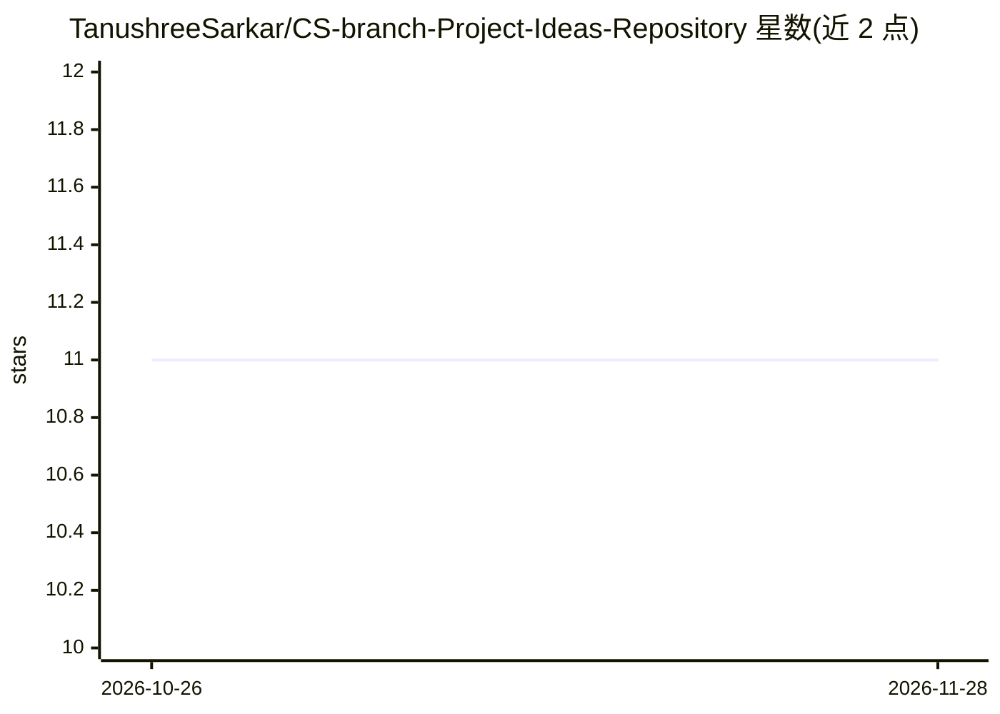

# TanushreeSarkar/CS-branch-Project-Ideas-Repository

⭐ 11 · 推送 2026-08-15 · [GitHub](https://github.com/TanushreeSarkar/CS-branch-Project-Ideas-Repository) · 个人维护

**给 CS 学生提供分方向的非陈词滥调项目创意清单**

按计算机科学分支组织的项目创意合集：覆盖软件工程、数据科学、人工智能、网络安全、Web、移动开发、云计算与 DevOps 八个方向，每方向 5+ 条创意，含技术栈与难度分层说明。用法是 clone 仓库后阅读各分支 Markdown 文件，挑选创意构建作品加入作品集；接受通过 fork + pull request 贡献新创意，采用 MIT 许可。

## 筛选速览

| 维度 | 判定 | 备注 |
|---|---|---|
| AI 角色 | `ai-knowledge` | 知识聚合/清单类 |
| 许可风险 | `none` | — |
| 部署形态 | `None` |  |
| 模型依赖 | — | README 未给出锁定关系 |
| 硬件要求 | — | 无带数字的原话,不猜 |
| 安装摩擦 | `low` | 无编译、无系统依赖或容器化 |
| 成熟度 | — | 结构信号不足 |

## 能力要点

- 8 个 CS 分支各含 5+ 条项目创意
- 创意附带技术栈与技能难度分层
- 以 Markdown 文件组织内容，社区可贡献

## 适用场景

- 为求职作品集挑选一个有区分度的项目来做
- 课程或毕业设计选题时寻找方向灵感
- 向该仓库贡献自己的项目创意

## 场景标签

`精选清单` · 领域:学习与行业

## 证据(README 行号)

> L5: Welcome to the **Non-Cliché CS Project Ideas Repository**! 🎉 Tired of seeing the same old to-do apps and basic chatb
> L14: |🛠️ Software Engineering|Projects|

## 星数曲线

2026-10-26 11 → 2026-11-28 11（+0）

---
*卡片 v1 · prompt 1.4 · 生成 2026-11-18 · 置信度 high · 依据 README sha `5b2eb2b611af` · [字段定义](../../DATASET.md)*
