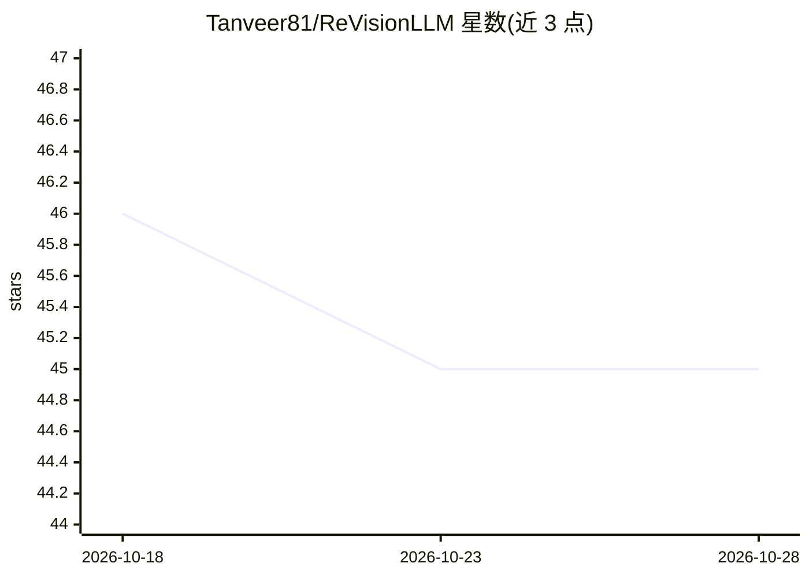

# Tanveer81/ReVisionLLM

⭐ 45 · Python · NOASSERTION · 推送 2025-11-05 · [GitHub](https://github.com/Tanveer81/ReVisionLLM) · [官网](https://arxiv.org/abs/2411.14901) · 组织维护

**在小时级长视频中定位事件时刻的递归视觉-语言模型**

CVPR 2025 论文 ReVisionLLM 的官方实现：一个递归视觉-语言模型，用于小时级长视频的时序定位（temporal grounding）。机制上先定位较宽的兴趣片段，再递归收窄至精确时间边界，可处理数分钟到数小时不等长度的视频；配套渐进式分层训练策略，先用短视频片段训练再扩展到长视频。提供 MAD 与 VidChapters-7M 两个数据集的数据处理、训练与推理脚本，模型权重可下载；编码器与 LLM 权重依赖 CLIP 与 Vicuna-v1.5。采用 CC BY-NC-ND 4.0 许可（禁商用、禁演绎）。

## 筛选速览

| 维度 | 判定 | 备注 |
|---|---|---|
| AI 角色 | `ai-native` | 本体是模型或模型工具 |
| 许可风险 | `none` | NOASSERTION |
| 部署形态 | `library` | 以包/库形式分发 |
| 模型依赖 | — | README 未给出锁定关系 |
| 硬件要求 | — | 无带数字的原话,不猜 |
| 安装摩擦 | `medium` | 含编译或系统依赖之一 |
| 成熟度 | — | 结构信号不足 |

## 能力要点

- 递归机制处理分钟到小时级视频的时序定位
- 渐进式分层训练策略（短视频→长视频）
- 提供 MAD 与 VidChapters-7M 的完整训练/推理脚本与模型权重

## 适用场景

- 在长视频研究项目中复现时序定位实验
- 基于官方权重对 MAD/VidChapters 数据集做推理评测
- 作为长视频理解研究的基线实现

## 场景标签

`多模态` `科研工具` · 领域:学习与行业

## 证据(README 行号)

> L17: ReVisionLLM is a recursive vision-language model designed to locate events in hour-long videos. Inspired by human s
> L23: - We extend the existing VLMs to enable temporal grounding capabilities in hour-long videos.

## 星数曲线

2026-10-18 46 → 2026-10-28 45（-1）

---
*卡片 v1 · prompt 1.4 · 生成 2026-10-25 · 置信度 mid · 依据 README sha `c8dd7c143b69` · [字段定义](../../DATASET.md)*
