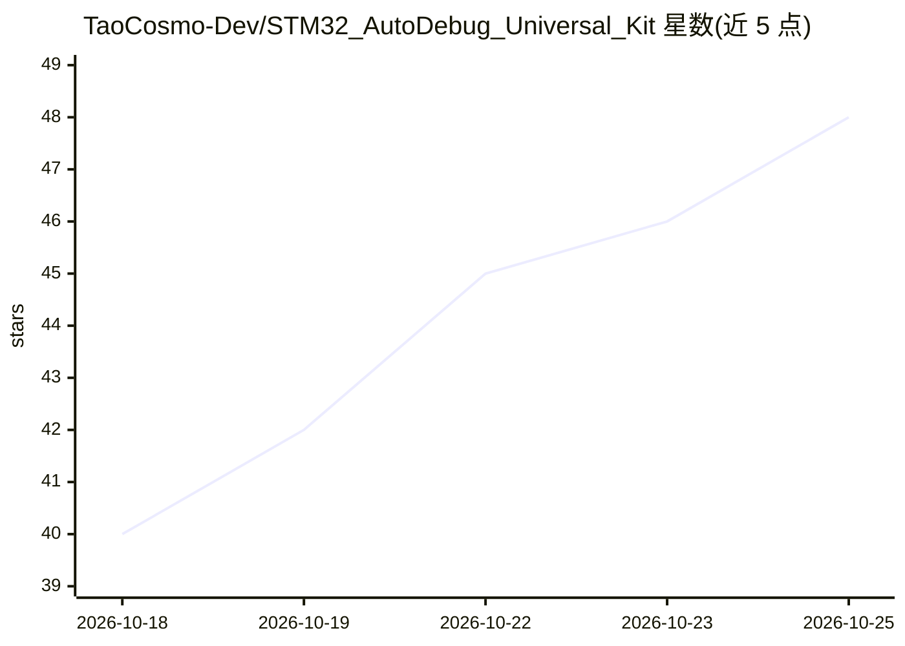

# TaoCosmo-Dev/STM32_AutoDebug_Universal_Kit

⭐ 49 · Python · MIT · 推送 2026-09-30 · [GitHub](https://github.com/TaoCosmo-Dev/STM32_AutoDebug_Universal_Kit) · 组织维护 · 中文 README

**让 AI 代理闭环开发 STM32：编译、烧录、上板验证、崩溃定位到源码行**

面向 AI 编码代理的 STM32 嵌入式工具链，把编译、SWD 烧录、串口验证与崩溃归因封装为命令行命令，以退出码（0-7 种状态）作为唯一判定结论。命令行驱动 Keil UV4 解析编译错误（文件+行号），通过 SWD 读取 Cortex-M 故障寄存器并借助 .axf 的 DWARF 调试信息将崩溃 PC 映射回源码行，另有 cm_backtrace_lite 固件侧串口备份通道。以 Agent Skill（SKILL.md）接入 Claude Code、Cursor 等编辑器，或以 MCP Server（10 个工具）方式调用。限制：仅 Windows、仅 Keil 工具链、不生成新工程、需 SWD 调试器，串口用于最终验收判定。

## 筛选速览

| 维度 | 判定 | 备注 |
|---|---|---|
| AI 角色 | `ai-ecosystem` | LLM/agent 周边工具 |
| 许可风险 | `permissive` | MIT |
| 部署形态 | `desktop` | 安装包/桌面程序 |
| 模型依赖 | — | README 未给出锁定关系 |
| 硬件要求 | — | 无带数字的原话,不猜 |
| 安装摩擦 | `low` | 无编译、无系统依赖或容器化 |
| 成熟度 | — | 结构信号不足 |

## 能力要点

- 命令行驱动 Keil UV4 编译并解析出带文件名与行号的错误
- SWD 读取故障寄存器 + DWARF 反查，将崩溃定位到具体源码行
- 退出码契约（TEST_PASSED/HARD_FAULT/STALLED 等）作为代理可判定的结论
- 失败指纹识别修复停滞，同一失败重复出现时终止自动修复转人工

## 适用场景

- 让 AI 代理自主编写、编译、烧录并验证 STM32 固件
- HardFault 等运行时崩溃自动归因到源码行
- 在 Claude Code/Cursor 等编辑器中对 Keil 工程执行闭环开发

## 场景标签

`编码 Agent` · 领域:编码与开发

## 证据(README 行号)

> L3: **面向 AI 代理的 STM32 闭环开发工具链**：编译、烧录、实机验证、崩溃归因，全部以命令行驱动，结果以退出码交付。
> L262: **工作机制**：`setup_env` 最后安装的 Skill 即为入口。`SKILL.md` 是开放标准，Claude Code、Cursor、Codex CLI、Gemini CLI、Cline、Windsurf、Copi

## 星数曲线

2026-10-18 40 → 2026-10-25 48（+8）

---
*卡片 v1 · prompt 1.4 · 生成 2026-10-25 · 置信度 mid · 依据 README sha `f74d4e3a5065` · [字段定义](../../DATASET.md)*
