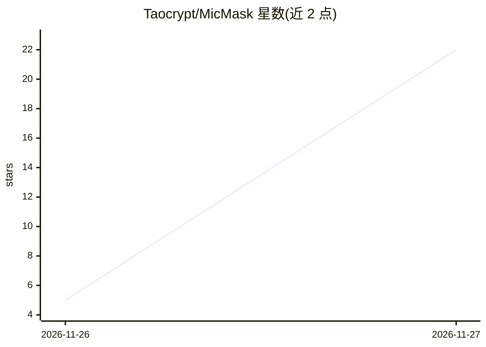

# Taocrypt/MicMask

⭐ 22 · Kotlin · GPL-3.0 · 推送 2026-11-26 · [GitHub](https://github.com/Taocrypt/MicMask) · [官网](https://micmask.taocrypt.com) · 个人维护 · 中文 README

**安卓本地实时 AI 变声应用，输出直接送入其他应用麦克风**

Android 端变声软件：通过 Shizuku 以 shell 身份注入麦克风，将 RVC 音色转换的实时结果直接送进 QQ、微信、游戏等应用的麦克风，无需 Root 或虚拟机。AI 推理由 ONNX Runtime 在手机 CPU 上本地运行，端到端延迟约 300ms（骁龙 8 Gen 3 实测），录音不上传。不附带任何音色模型，用户从模型仓库下载或导入 .pth+.index 文件。通过 GitHub Releases 分发 arm64-v8a APK，GPL-3.0 许可，无订阅无内购。

## 筛选速览

| 维度 | 判定 | 备注 |
|---|---|---|
| AI 角色 | `ai-native` | 本体是模型或模型工具 |
| 许可风险 | `viral` | GPL-3.0 |
| 部署形态 | `None` |  |
| 模型依赖 | — | README 未给出锁定关系 |
| 硬件要求 | — | 无带数字的原话,不猜 |
| 安装摩擦 | `medium` | 含编译或系统依赖之一 |
| 成熟度 | — | 结构信号不足 |

## 能力要点

- 本地 RVC 实时推理，录音不上传，延迟约 300ms
- Shizuku 注入麦克风，无需 Root、无需虚拟机
- 支持导入 RVC .pth+.index 与 w-okada 导出的 ONNX，模型仓库一键下载
- 另有本地 GPT-SoVITS 中文文字转语音与整段文件变声功能

## 适用场景

- 在 QQ、微信语音通话中实时变换音色
- 游戏开麦时使用变声或音效包送麦
- 把整段录音文件批量转换成其他音色

## 场景标签

`语音合成` · 领域:内容生成

## 证据(README 行号)

> L3: **安卓端真正的原生实时 AI 变声软件**
> L11: MicMask 在手机本地把你的声音实时转换成另一个音色，并直接送进 QQ、微信、游戏等应用的麦克风。对方听到的，就是变声后的声音。
> L17: - **真·本地 AI 实时推理**：基于 RVC 音色转换，ONNX Runtime 在手机 CPU 上运行，录音全程不上传。

## 星数曲线

2026-11-26 5 → 2026-11-27 22（+17）

---
*卡片 v1 · prompt 1.4 · 生成 2026-11-26 · 置信度 high · 依据 README sha `837a77ca4e7e` · [字段定义](../../DATASET.md)*
