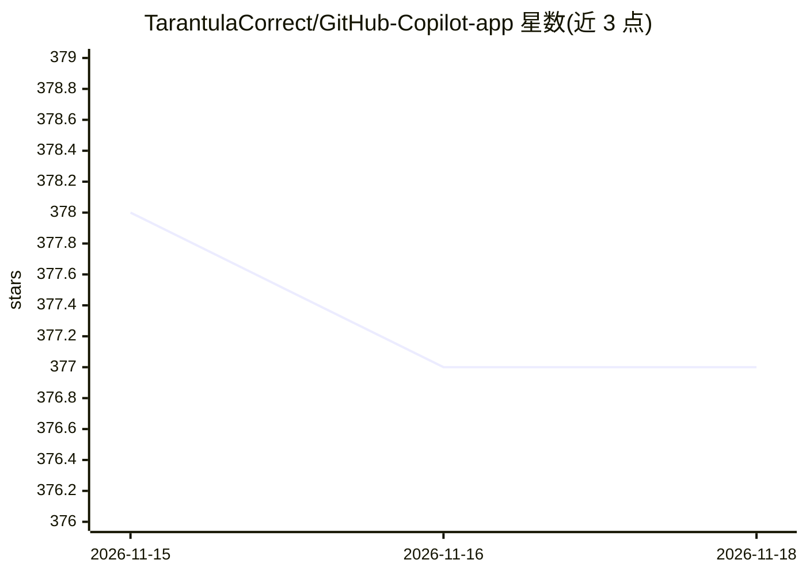

# TarantulaCorrect/GitHub-Copilot-app

⭐ 377 · Apache-2.0 · 推送 2026-11-15 · [GitHub](https://github.com/TarantulaCorrect/GitHub-Copilot-app) · 组织维护

**桌面端 Copilot 代理工作台：跨仓库发现、运行与落地开发任务**

GitHub 维护的代理驱动桌面应用：在一个控制中心内跨 GitHub 仓库查找待办工作（issues、PR、会话）、启动和引导 Copilot 代理、通过 Canvas 面板检视计划/终端/差异、并用 Agent Merge 将 PR 推过评审与合并流程。本地会话运行于隔离的 git worktree，云端会话运行于 GitHub 托管的隔离环境。需 Git 与任意 Copilot 订阅，也支持自带模型 key（BYOK）。通过下载链接与 Releases 页分发安装包，代码未开源（© GitHub, Inc. 保留所有权利）。

## 筛选速览

| 维度 | 判定 | 备注 |
|---|---|---|
| AI 角色 | `ai-ecosystem` | LLM/agent 周边工具 |
| 许可风险 | `permissive` | Apache-2.0 |
| 部署形态 | `desktop` | 安装包/桌面程序 |
| 模型依赖 | — | README 未给出锁定关系 |
| 硬件要求 | — | 无带数字的原话,不猜 |
| 安装摩擦 | `low` | 无编译、无系统依赖或容器化 |
| 成熟度 | — | 结构信号不足 |

## 能力要点

- 本地会话各自运行在隔离 git worktree，支持并行代理开发
- Canvas 将代理计划、终端、差异与工作流状态呈现为可检视/可改向的面板
- Automations 将可重复提示与工作流转为定时或后台任务
- 支持 BYOK 自带模型提供方，无需 Copilot 订阅也可使用

## 适用场景

- 在一个界面里跨仓库管理从想法到 PR 的开发工作
- 并行运行多个代理分别调查 bug、实现 issue、处理评审意见
- 把重复性提示与工作流设为定时后台任务
- 让代理把 PR 推过评审、检查与合并条件

## 场景标签

`编码 Agent` `工作流自动化` · 领域:效率与自动化

## 证据(README 行号)

> L3: The GitHub Copilot app is an agent-native desktop experience for finding, running, steering, and landing software wo
> L13: The GitHub Copilot app is an agent-native desktop experience for managing software work from idea to pull request. 
> L15: The app is built for parallel agent-driven development. Each local session runs in its own isolated git worktree, a

## 星数曲线

2026-11-15 378 → 2026-11-18 377（-1）

---
*卡片 v1 · prompt 1.4 · 生成 2026-11-17 · 置信度 mid · 依据 README sha `f4e4cad8cfa9` · [字段定义](../../DATASET.md)*
