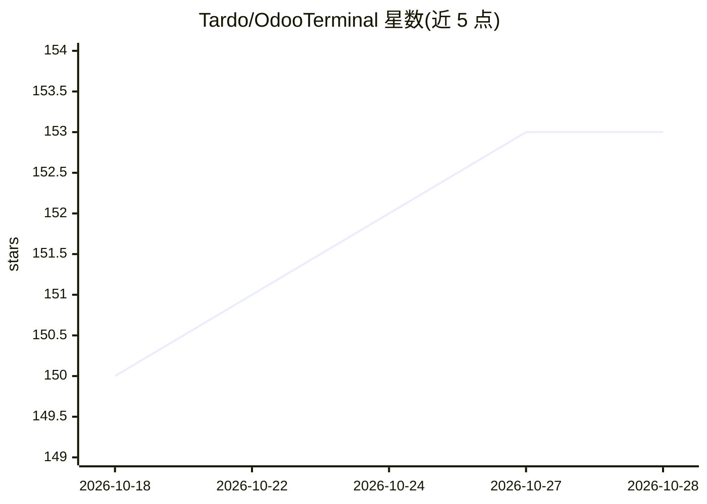

# Tardo/OdooTerminal

⭐ 153 · JavaScript · MIT · 推送 2026-10-03 · [GitHub](https://github.com/Tardo/OdooTerminal) · 个人维护

**Odoo 开发者浏览器终端扩展：用命令操作 Odoo json-rpc**

面向 Odoo 开发者的 WebExtension（支持 Odoo 11–20），在 Odoo 页面中注入类终端界面，通过 create/search/read/call 等命令直接调用 Odoo 框架的 json-rpc 工具，不修改 Odoo 类。支持别名、recordset 写入、嵌套调用、for 循环批量操作、文件上传、websocket（Odoo 16.0+）等。另含 AI 模式（autonomous agent），通过终端工具栏 AI 按钮访问。发布于 Mozilla/Chrome/Edge 插件商店，首次加载页面后初始化，使用开销约 24ms。

## 筛选速览

| 维度 | 判定 | 备注 |
|---|---|---|
| AI 角色 | `ai-enhanced` | 去掉 AI 部分产品仍成立 |
| 许可风险 | `permissive` | MIT |
| 部署形态 | `None` |  |
| 模型依赖 | — | README 未给出锁定关系 |
| 硬件要求 | — | 无带数字的原话,不猜 |
| 安装摩擦 | `low` | 无编译、无系统依赖或容器化 |
| 成熟度 | — | 结构信号不足 |

## 能力要点

- 终端命令直接调用 Odoo json-rpc（create/search/read/call 等）
- 支持别名、recordset 写入、嵌套调用与 for 循环批量操作
- websocket 连接支持（Odoo 16.0+）
- 含 AI 模式（autonomous agent，终端工具栏 AI 按钮访问）

## 适用场景

- 在 Odoo 前后台快速创建、查询、修改记录
- 批量执行操作（如批量创建伙伴、取消订单）
- 为重复操作定义别名命令并在每次会话自动运行

## 场景标签

 · 领域:企业管理软件（Odoo）开发工具

## 证据(README 行号)

> L16: This web extension adds a terminal-like to control Odoo (11 to 20). All implemented commands use the tools provided
> L32: The terminal also includes an **AI mode** (autonomous agent) accessible via the AI button in the terminal toolbar.

## 星数曲线

2026-10-18 150 → 2026-10-28 153（+3）

---
*卡片 v1 · prompt 1.4 · 生成 2026-10-22 · 置信度 high · 依据 README sha `6e4a66b46abb` · [字段定义](../../DATASET.md)*
