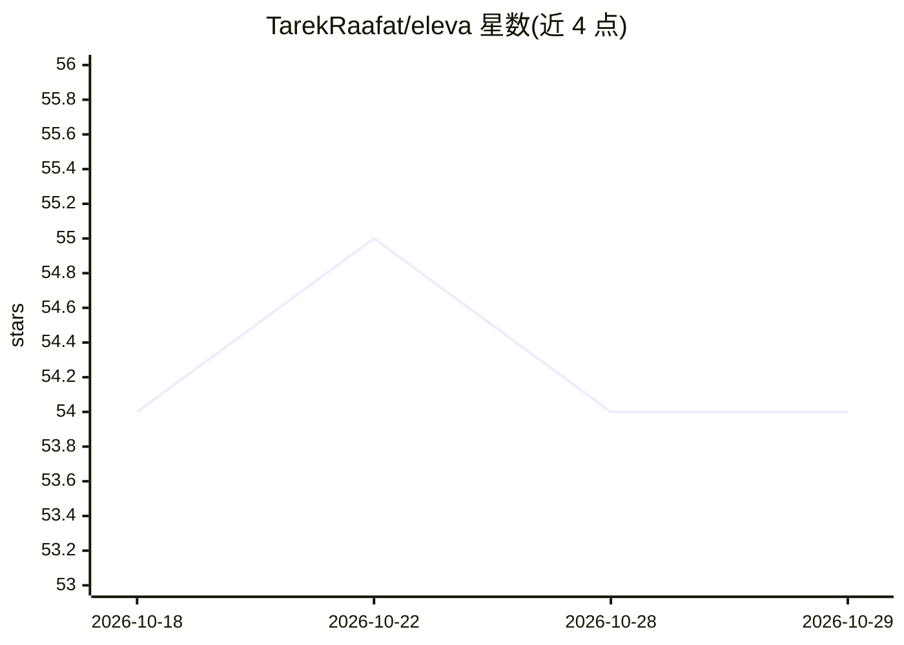

# TarekRaafat/eleva

⭐ 54 · JavaScript · MIT · 推送 2026-06-28 · [GitHub](https://github.com/TarekRaafat/eleva) · [官网](https://elevajs.com) · 个人维护

**轻量原生 JS 前端框架，内置 AI Agent 插件**

约 2.5KB（gzip）的纯原生 JavaScript 前端运行时框架，零依赖、无需构建步骤，通过 CDN 直接在浏览器运行。核心提供组件化架构、signal 细粒度响应式、DOM diffing、事件发射器与插件系统；内置 Router、Store、Attr、Agent 插件，其中 Agent 插件面向 LLM 集成，提供 action 注册表、审计日志与权限。作者定位其为 React/Vue/Angular 之外的轻量替代选择，适用于包体敏感项目、微前端与 10K+ 行数据看板。

## 筛选速览

| 维度 | 判定 | 备注 |
|---|---|---|
| AI 角色 | `ai-enhanced` | 去掉 AI 部分产品仍成立 |
| 许可风险 | `permissive` | MIT |
| 部署形态 | `library` | 以包/库形式分发 |
| 模型依赖 | — | README 未给出锁定关系 |
| 硬件要求 | — | 无带数字的原话,不猜 |
| 安装摩擦 | `low` | 无编译、无系统依赖或容器化 |
| 成熟度 | — | 结构信号不足 |

## 能力要点

- 约 2.5KB gzip、零依赖、无需构建步骤，CDN 直接运行
- signal 细粒度响应式与无虚拟 DOM 的 DOM diffing
- Agent 插件提供 LLM 集成、action 注册表、审计日志与权限
- 内置 Router/Store/Attr 插件，提供 ESM/CommonJS/UMD 构建

## 适用场景

- 构建包体敏感的嵌入式组件或微前端
- 性能敏感的数据看板（10K+ 行虚拟滚动）
- 为界面接入 LLM Agent 操作（action 注册与审计）
- 无构建工具的快速原型开发

## 场景标签

`Agent 框架` · 领域:Agent 开发

## 证据(README 行号)

> L31: **Eleva** is a minimalist, lightweight (~2.5KB gzipped), pure vanilla JavaScript frontend framework crafted for **e
> L39: - **Is AI-agent-ready** - Built-in Agent plugin for LLM integration, action registry, and audit logging
> L146: - **🎯 Built-in Plugins:** Attr for advanced attributes, Router for client-side routing, Store for reactive state m

## 星数曲线

2026-10-18 54 → 2026-10-29 54（+0）

---
*卡片 v1 · prompt 1.4 · 生成 2026-10-24 · 置信度 high · 依据 README sha `0962fe9f5c5d` · [字段定义](../../DATASET.md)*
