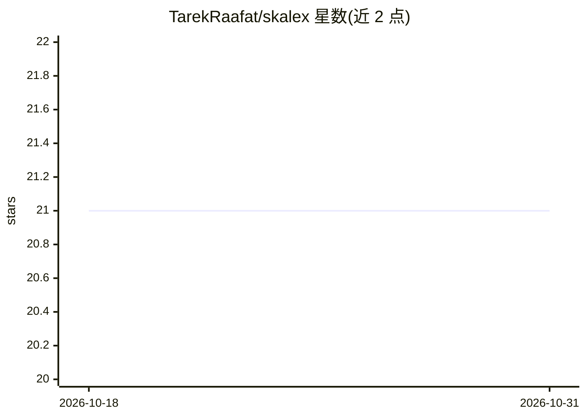

# TarekRaafat/skalex

⭐ 21 · JavaScript · Apache-2.0 · 推送 2026-09-07 · [GitHub](https://github.com/TarekRaafat/skalex) · [官网](https://tarekraafat.github.io/skalex) · 个人维护

**零依赖 JavaScript 本地优先数据库，内置向量搜索与 agent 记忆**

面向开发者的纯 JavaScript NoSQL 数据库，数据常驻进程内存，支持 Node.js/Bun/Deno/浏览器/edge 运行时。核心是文档 CRUD、MongoDB 风格查询算子、索引、事务、迁移、软删除等传统数据库能力；AI 相关功能内置：插入时自动嵌入与余弦相似度搜索（OpenAI/Ollama 适配器）、db.ask() 自然语言转过滤条件（OpenAI/Anthropic/Ollama）、episodic agent memory、一行启动 MCP server 供 Claude Desktop 与 Cursor 调用，另有 AES-256-GCM 静态加密。明确声明适用于数据可放入 RAM 的单进程场景，非 PostgreSQL/MongoDB 替代。文档针对 v4.0.0-alpha.7 预发布版本。

## 筛选速览

| 维度 | 判定 | 备注 |
|---|---|---|
| AI 角色 | `ai-enhanced` | 去掉 AI 部分产品仍成立 |
| 许可风险 | `permissive` | Apache-2.0 |
| 部署形态 | `library` | 以包/库形式分发 |
| 模型依赖 | local-ok | 支持本地模型 |
| 硬件要求 | — | 无带数字的原话,不猜 |
| 安装摩擦 | `low` | 无编译、无系统依赖或容器化 |
| 成熟度 | `idea` | |

## 能力要点

- 零依赖、核心包 ~28 KB gzipped，CI 强制字节预算
- 插入时自动嵌入与 cosine 相似度搜索，内置 OpenAI/Ollama 嵌入适配器
- db.mcp() 一行将数据库暴露为 MCP 工具（stdio/http+SSE，按集合读写权限控制）
- 可插拔存储适配器（Node 文件系统/浏览器 LocalStorage/加密/Cloudflare D1/Bun SQLite/LibSQL）

## 适用场景

- 为 AI agent 或 CLI 工具提供带向量搜索的嵌入式本地存储
- 给 Claude Desktop/Cursor 等客户端通过 MCP 暴露数据库工具
- 为单进程桌面/edge 应用提供免运维的本地优先数据库

## 场景标签

`Agent 记忆` `语义搜索` `向量数据库` · 领域:Agent 开发

## 证据(README 行号)

> L13: > `Skalex` ships **vector search, agent memory, natural language queries, an MCP server, and AES-256-GCM encryption
> L15: > **Architecture + fit:** all data lives in your process's heap - `db.connect()` loads the full dataset for instant
> L20: - **Zero dependencies**: install the package, nothing else. No driver, no ORM, no server process.

## 星数曲线

2026-10-18 21 → 2026-10-31 21（+0）

---
*卡片 v1 · prompt 1.4 · 生成 2026-10-28 · 置信度 high · 依据 README sha `a3c606cddeca` · [字段定义](../../DATASET.md)*
