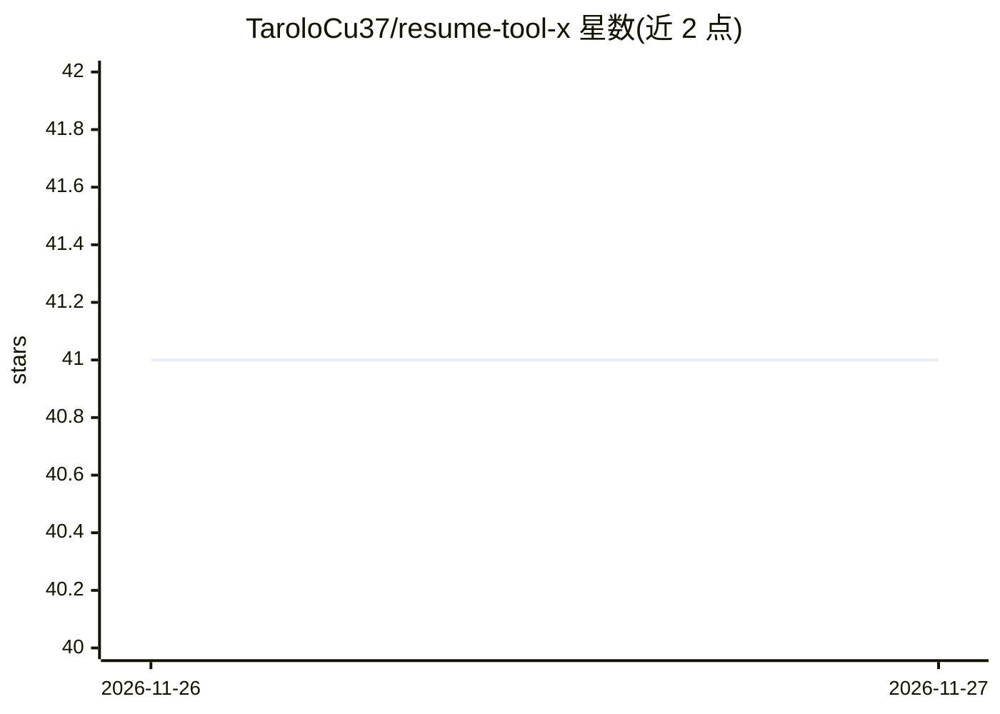

# TaroloCu37/resume-tool-x

⭐ 41 · C++ · MIT · 推送 2026-11-25 · [GitHub](https://github.com/TaroloCu37/resume-tool-x) · 个人维护

**给求职者生成 ATS 友好简历的便携 Windows 工具**

自称 AI 简历生成器，以预构建的 Windows 10/11 x64 便携包发布，无编译器与外部依赖，配置文件为 config/settings.json 且支持热重载；README 未说明 AI 模型或服务的具体机制。安装方式为下载 zip、用访问码解压后运行 Setup 程序；另提供从源码用 CMake 构建的流程。文档含使用指南、贡献说明、FAQ 与 changelog。

## 筛选速览

| 维度 | 判定 | 备注 |
|---|---|---|
| AI 角色 | `ai-native` | 本体是模型或模型工具 |
| 许可风险 | `permissive` | MIT |
| 部署形态 | `desktop` | 安装包/桌面程序 |
| 模型依赖 | — | README 未给出锁定关系 |
| 硬件要求 | — | 无带数字的原话,不猜 |
| 安装摩擦 | `medium` | 含编译或系统依赖之一 |
| 成熟度 | — | 结构信号不足 |

## 能力要点

- 预构建 Windows x64 便携包，无需编译器或外部依赖
- JSON 配置支持热重载
- 提供 CMake 源码构建流程

## 适用场景

- 快速生成面向 ATS 筛选的简历
- 在 Windows 上免安装便携运行简历工具

## 场景标签

`AI 写作` · 领域:内容生成

## 证据(README 行号)

> L1: # AI Resume Builder — AI Resume Builder — AI resume builder: ATS-optimized CVs in minutes. (Hot-Reload Config, Zero 
> L18: **AI Resume Builder — AI Resume Builder — resume tool x suite** (`resume-tool-x`) is a portable Windows 10/11 runti

## 星数曲线

2026-11-26 41 → 2026-11-27 41（+0）

---
*卡片 v1 · prompt 1.4 · 生成 2026-11-26 · 置信度 low · 依据 README sha `28cf14720fa4` · [字段定义](../../DATASET.md)*
