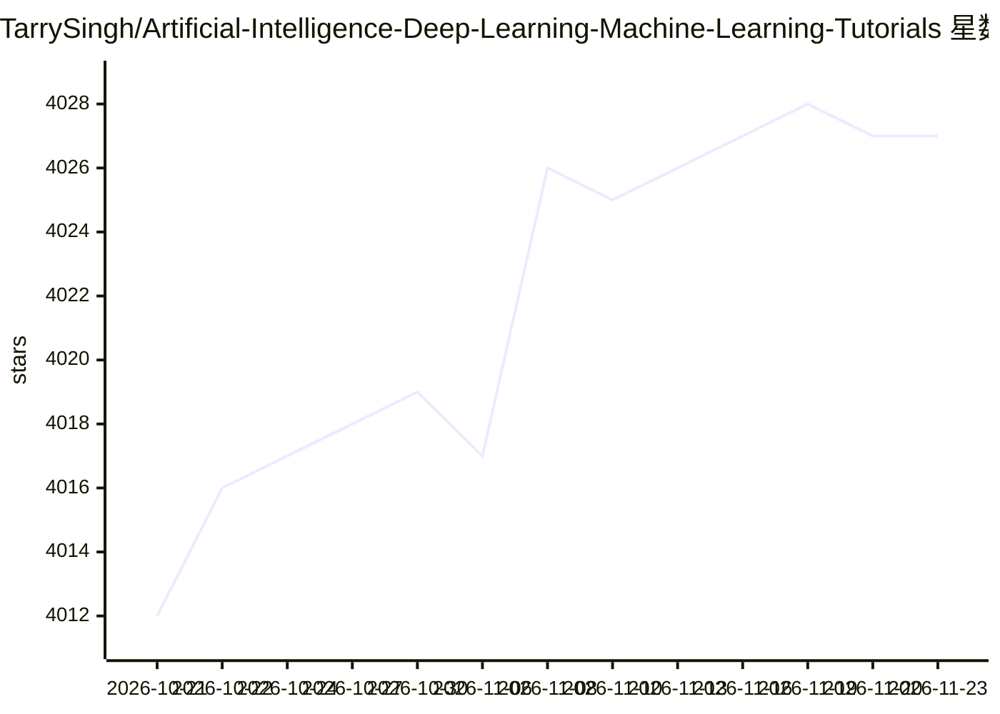

# TarrySingh/Artificial-Intelligence-Deep-Learning-Machine-Learning-Tutorials

⭐ 4,027 · Python · NOASSERTION · 推送 2026-11-20 · [GitHub](https://github.com/TarrySingh/Artificial-Intelligence-Deep-Learning-Machine-Learning-Tutorials) · [官网](https://synapsa.realai.eu) · 组织维护

**免费实操 AI 课程库：在 Colab/Jupyter 上做中学**

原 2017-2025 教程已退役，现改为 Synapsa Commons 课程集：108 个可自动评分的 notebook 课程，覆盖 EU AI Act 合规证据、模型验证、预测性维护、文档抽取、检索与 RAG、agent 与 MCP、模拟人形机器人等，按 7 个 programme 与 11 个 track 组织。课程在 Colab/Kaggle/Binder/Codespaces/本地 Jupyter 打开，每个练习运行即自检，部分 C/C++ 练习需 make 与编译器。

## 筛选速览

| 维度 | 判定 | 备注 |
|---|---|---|
| AI 角色 | `ai-knowledge` | 知识聚合/清单类 |
| 许可风险 | `none` | NOASSERTION |
| 部署形态 | `library` | 以包/库形式分发 |
| 模型依赖 | — | README 未给出锁定关系 |
| 硬件要求 | — | 无带数字的原话,不猜 |
| 安装摩擦 | `medium` | 含编译或系统依赖之一 |
| 成熟度 | — | 结构信号不足 |

## 能力要点

- 108 个课程均通过 14 项质量门并独立评审
- 每个 notebook 在 Colab、Kaggle、Binder、Codespaces 或本地 Jupyter 打开
- 练习自动评分：运行即判对错并给出两级提示
- 每周一/三/五更新新课程

## 适用场景

- 零基础按入门路径逐步学 Python 与 AI
- ML 工程师按 track 学 agent、RAG、推理系统与治理
- 行业专家学 EU AI Act 合规、信贷风控等领域课程

## 场景标签

`教程课程` `RAG` · 领域:知识与检索

## 证据(README 行号)

> L1: Synapsa Commons: learn AI by building it
> L3:  Free, hands-on AI courses that run anywhere , from the team building Synapsa, an AI-native learning platform.
> L52: **108 lessons, every one passing all 14 gates in `QUALITY.md` and independently reviewed.** 8 are compiled C or C++

## 星数曲线

2026-10-21 4,012 → 2026-11-23 4,027（+15）

---
*卡片 v1 · prompt 1.4 · 生成 2026-11-23 · 置信度 high · 依据 README sha `1577c1b5ee6b` · [字段定义](../../DATASET.md)*
